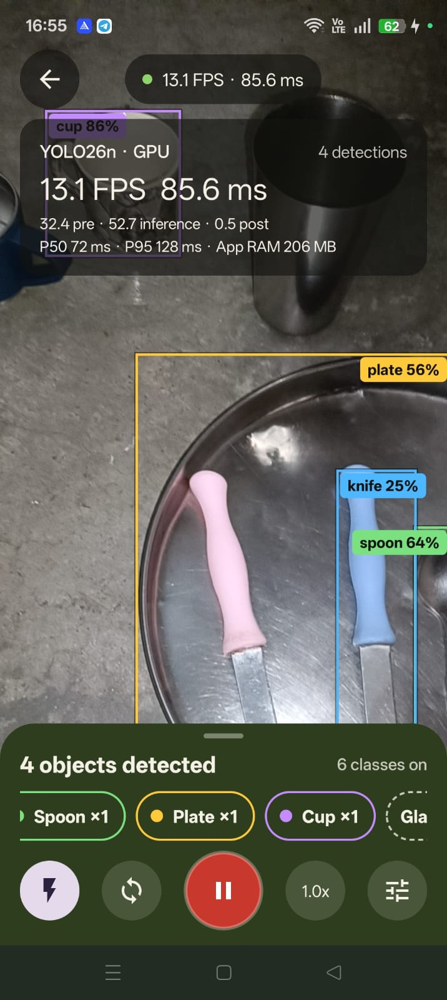
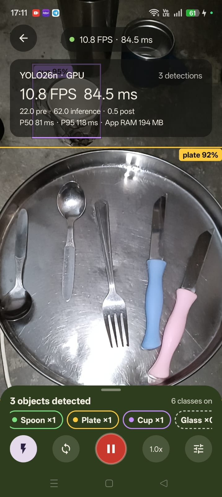
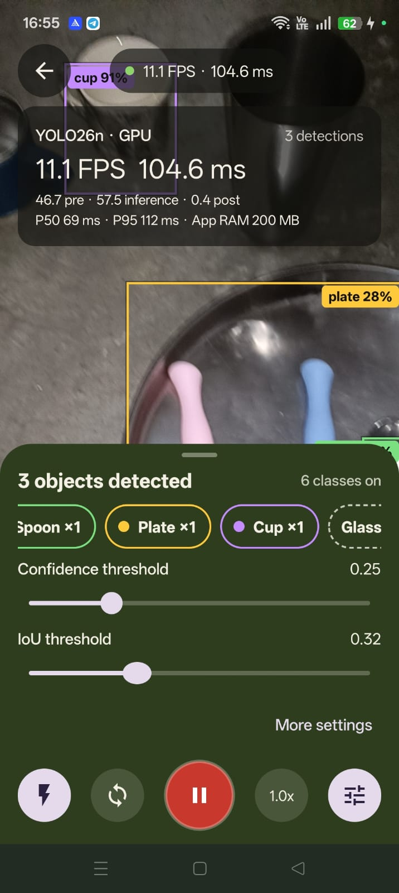
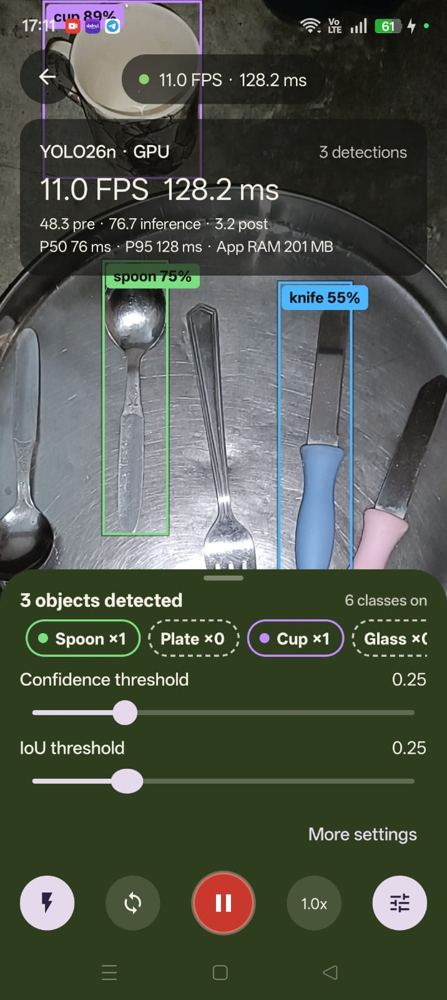
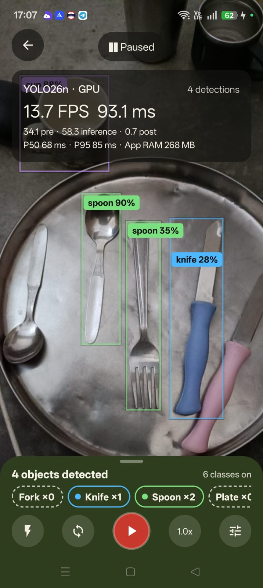
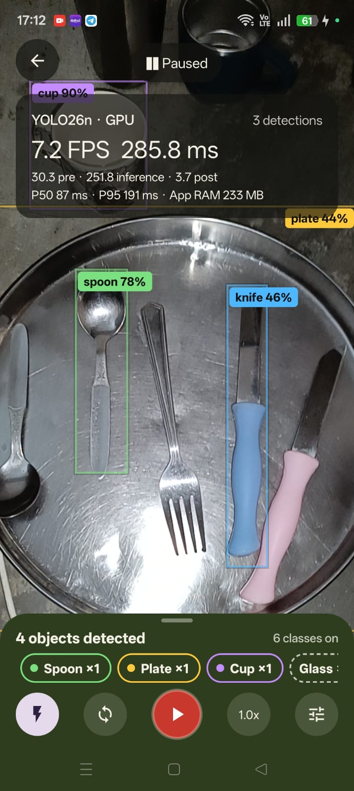
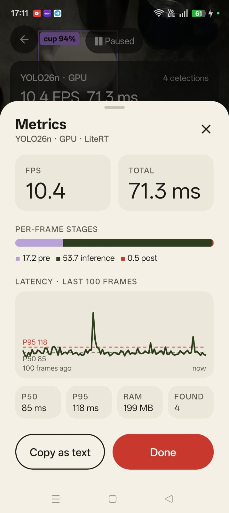
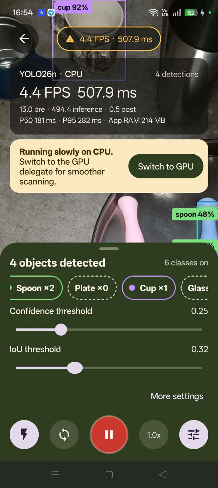
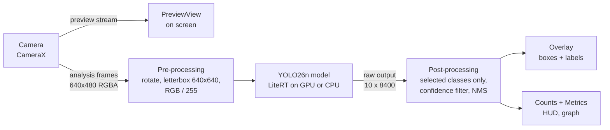

# Wareye (Android app)

Live kitchenware detection on an Android phone. Point the camera at a table and Wareye draws a box around every **plate, spoon, fork, knife, cup and glass** it sees, in real time, entirely on the phone.

- **Author:** Raunak
- **Version:** 1.0.0 (`com.raunak.wareye`)
- **Model:** YOLO26n, w8a32, LiteRT format (2.72 MB)
- **Training pipeline, dataset and model export:** the parent [Wareye repository](https://github.com/raunakgola/Wareye)

## Screenshots

<div align="center">
<table>
  <tr>
    <td align="center"><br><sub>Live scan, class counts<br>and metrics card</sub></td>
    <td align="center"><br><sub>Plate detected,<br>torch on</sub></td>
    <td align="center"><br><sub>Confidence and IoU<br>sliders</sub></td>
    <td align="center"><br><sub>Sliders while<br>scanning cutlery</sub></td>
  </tr>
  <tr>
    <td align="center"><br><sub>Paused, play button<br>resumes</sub></td>
    <td align="center"><br><sub>Paused, HUD card<br>frozen</sub></td>
    <td align="center"><br><sub>Metrics sheet<br>and latency graph</sub></td>
    <td align="center"><br><sub>Slow on CPU,<br>Switch to GPU</sub></td>
  </tr>
</table>
</div>

<p align="center"><a href="https://github.com/user-attachments/assets/8ab2b2bc-1ccf-416d-ae1b-61e0350f5c3c">Watch the demo video</a></p>

<p align="center">📥 <b>Download:</b> <a href="https://github.com/raunakgola/Wareye/releases/latest">Wareye-v1.0.0.apk</a> (Android 6.0+, 64-bit ARM, about 7 MB)</p>

**Contents**

1. [Features](#1-features)
2. [Using the app](#2-using-the-app)
3. [Requirements and libraries](#3-requirements-and-libraries)
4. [Build and install](#4-build-and-install)
5. [How it works](#5-how-it-works)
6. [Data and privacy](#6-data-and-privacy)
7. [Metrics: what the numbers and the graph mean](#7-metrics-what-the-numbers-and-the-graph-mean)
8. [Make it your own: rebrand and sign](#8-make-it-your-own-rebrand-and-sign)
9. [Use a different model or add classes](#9-use-a-different-model-or-add-classes)
10. [Project structure](#10-project-structure)
11. [App size](#11-app-size)
12. [Troubleshooting](#12-troubleshooting)
13. [Credits and licenses](#13-credits-and-licenses)

---

## 1. Features

- **6 classes:** plate, spoon, fork, knife, cup, glass. You pick which ones to look for; the others are ignored.
- **On-device:** the model runs on the phone with Google's LiteRT runtime. No server, no account, no internet permission.
- **GPU with CPU fallback:** Wareye tries the phone's GPU first. If the GPU cannot run the model, it switches to the CPU automatically and tells you which one is in use (`YOLO26n · GPU` or `YOLO26n · CPU`).
- **Live controls:** confidence and IoU sliders (applied instantly), torch, zoom (1x / 2x / 5x or pinch), front/back camera, pause.
- **Performance metrics:** FPS, latency per stage, P50/P95 latency and a latency graph of the last 100 frames.
- **Works in portrait and landscape** without reloading the model or restarting the camera.

## 2. Using the app

1. **Home.** The chip under the logo shows the model and where it runs (`YOLO26n · GPU`). Tap it to open **Settings**. Tap the big red button to start.
2. **Choose classes.** Tap tiles to select what to detect, or use **Select all** per category (Cutlery: fork, knife, spoon; Tableware: plate, cup, glass). **Recent → Use again** restores your last selection. Tap **Start scanning (N)**.
3. **Scan.** Boxes and labels (`fork 87%`) appear on the camera image. The bottom panel shows how many objects were found and a count per class.

Live-scan controls (bottom panel, left to right):

| Control | What it does |
|---|---|
| ⚡ Torch | Turns the flashlight on/off (greyed out if the camera has no flash). |
| ⟳ Flip | Switches front/back camera (greyed out with one camera). |
| ❚❚ Pause | Freezes the image and stops detection; tap again to resume. |
| 1.0x Zoom | Tap to cycle 1x, 2x, 5x (limited to what the camera supports). Pinch on the image also zooms. |
| ☰ Tune | Shows the **Confidence** and **IoU** sliders. **More settings** opens the Settings sheet. |

At the top: **←** back, and the **HUD pill** (`12.9 FPS · 69.7 ms`). Tap the pill to expand the metrics card; tap the card to open the **Metrics** sheet (see [section 7](#7-metrics-what-the-numbers-and-the-graph-mean)).

Messages you may see:

| Message | When | What to do |
|---|---|---|
| **Getting Wareye ready** | First start, or after changing CPU/GPU. Shows each loading step. | Wait a few seconds. The first GPU start is slower; later starts reuse a cache. |
| **Camera access is off** | Camera permission was denied. | **Open settings → Permissions → Camera → Allow**. The app re-checks when you come back. |
| **Couldn't load YOLO26n** | The GPU (or the model) failed to start. | **Run on CPU** (always works, slower), **Try GPU again**, or **Copy error details** to report it. |
| **Nothing detected yet** | No box for 2 seconds. | Move closer, add light, or tap **Lower to 0.15** to accept less certain detections. |
| **Running slowly on CPU** (amber pill) | Under 8 FPS for 3 seconds on the CPU. | Tap **Switch to GPU**. It clears after 3 seconds at 10 FPS or more. |

**Settings** (from the Home chip or **More settings**):

- **Delegate: CPU / GPU.** GPU is the default and faster. Changing it reloads the model.
- **Confidence threshold** (default 0.25): the minimum score for a box to be shown. Higher = fewer, surer boxes.
- **IoU threshold** (default 0.70): how much two boxes of the same class may overlap before the weaker one is removed (non-maximum suppression). Lower = more aggressive merging of duplicates.
- **Show metrics:** shows or hides the HUD pill.
- **Reset** restores the defaults.

## 3. Requirements and libraries

**To build:**

| Tool | Version used | Notes |
|---|---|---|
| Android Studio | 2026.1.3 or newer | Must support AGP 9.3. |
| JDK | 17 or newer | Android Studio's bundled JDK works. |
| Gradle | 9.8.1 | Downloaded automatically by the Gradle wrapper (`gradlew`). |
| Android Gradle Plugin (AGP) | 9.3.3 | AGP 9 compiles Kotlin itself (no separate Kotlin plugin applied). |
| Kotlin compiler | 2.3.21 | Pinned in the top-level `build.gradle.kts`; LiteRT 2.1.5 is built with Kotlin 2.3. |
| Android SDK Platform | 36 | Installed automatically on first build if the SDK licenses are accepted. |

**To run:** an Android phone with an **arm64** CPU (practically every phone from the last 8+ years) and **Android 6.0 (API 23)** or newer. 32-bit phones and x86 emulators are not supported by this build.

**Libraries** (all downloaded automatically by Gradle from Google Maven / Maven Central; nothing to install by hand):

| Library | Version | Used for |
|---|---|---|
| `com.google.ai.edge.litert:litert` | 2.1.5 | Running the model (`CompiledModel` API) on GPU or CPU. Includes the native runtime `libLiteRt.so` and the GPU accelerator `libLiteRtClGlAccelerator.so`. |
| `androidx.camera:camera-camera2` | 1.4.2 | CameraX camera backend. |
| `androidx.camera:camera-lifecycle` | 1.4.2 | Starts/stops the camera with the screen. |
| `androidx.camera:camera-view` | 1.4.2 | `PreviewView`, the on-screen camera preview. |
| `androidx.activity:activity` | 1.13.0 | `ComponentActivity`, permission request. |

LiteRT pulls in Play AI-pack download dependencies (`ai-delivery`, Guava, coroutines-guava) for a model-download feature this app does not use. They are **excluded** in `app/build.gradle.kts` to keep the app small, and `app/proguard-rules.pro` tells R8 to ignore them.

No AppCompat, Material Components, ConstraintLayout or Jetpack Compose are used by the app code: all screens are plain Android views with **XML layouts + ViewBinding**. Fonts are the phone's system fonts.

## 4. Build and install

### Run on your phone (development)

1. Install Android Studio. Open the **`Android_App` folder** (the one with `settings.gradle.kts`) and wait for **Gradle sync** to finish.
2. On the phone, enable **Developer options → USB debugging** (and on some phones, e.g. OPPO/ColorOS, **Install via USB**). Connect it by USB and accept the prompt.
3. Press **Run ▶**. Android Studio builds and installs the debug app.

### Command line

```bash
./gradlew assembleDebug
```
```bash
./gradlew assembleRelease
```

On Windows use `gradlew.bat` instead of `./gradlew`. Outputs:

- `app/build/outputs/apk/debug/Wareye-debug.apk`
- `app/build/outputs/apk/release/Wareye-release.apk` (shrunk with R8; **signed with the debug key** so it installs over USB; not for publishing)

### Signed release APK (to share or publish)

1. **Build → Generate Signed App Bundle / APK…** → choose **APK** (to share the file) or **Android App Bundle** (for Google Play).
2. **Key store path → Create new…** the first time (see [section 8.3](#83-create-your-signing-key)), or **Choose existing…** after that.
3. Pick the **release** variant → **Create**. The signed file appears in `app/release/` (e.g. `app/release/Wareye-release.apk`).

Install it on a phone by copying the APK and opening it, or:

```bash
adb install app/release/Wareye-release.apk
```

Android only updates an app if the new APK has the same app ID **and** the same signing key. A debug-signed and a release-signed copy cannot replace each other: uninstall first when switching.

## 5. How it works

### 5.1 The big picture



CameraX gives two streams of the same scene: a full-quality **preview** that Android draws on screen, and small **analysis frames** (640x480) that go to the model. Only the newest analysis frame is kept (`STRATEGY_KEEP_ONLY_LATEST`): if the model is busy, older frames are dropped instead of piling up, so the boxes always describe the latest image.

### 5.2 Loading the model (`Engine.kt`, `Detector.kt`)

`Engine` is a single, app-wide holder for the model. It starts loading as soon as the Home screen opens, so the scan screen is usually ready instantly, and the model stays loaded while you move between screens or rotate the phone.

Loading follows an **accelerator ladder**:

1. **GPU:** compile the model for the GPU delegate. The compiled GPU program is saved in the app's code cache (`codeCacheDir`), so the next start skips most of the compile time.
2. **Warm-up:** run the model once on an all-zero image. Some GPUs compile fine but fail on the first run, so this is part of the check.
3. If step 1 or 2 throws an error, **fall back to the CPU** (XNNPACK, 1 to 4 threads) and do the same warm-up.
4. The UI shows what actually runs. If the GPU failed, you get the "Couldn't load" screen once, with the CPU model already loaded behind it.

Loading and inference run on the **same background thread**, so a reload can never collide with a frame being processed.

### 5.3 One frame, step by step

1. **Copy** the RGBA camera frame into a reusable bitmap (handles phones that pad image rows).
2. **Rotate** it upright using the camera's `rotationDegrees`.
3. **Letterbox** it into 640x640: scale to fit while keeping the aspect ratio, center it, and fill the empty bars with gray (114, 114, 114). This matches how the model was validated with Ultralytics.
4. **Convert** pixels to floats 0..1 in the layout the model expects (NCHW: all red values, then green, then blue). The layout is detected from the model's real input shape, not assumed.
5. **Run** the model. Output: `[1, 10, 8400]` = for each of 8,400 candidate positions ("anchors"), 4 box values (center x, center y, width, height) + 6 class scores.
6. **Decode:** for each anchor, take the best score **among the classes you selected only**. Unselected classes never compete, so they cannot suppress or replace selected ones. Drop anchors under the confidence threshold.
7. **NMS (non-maximum suppression):** sort the survivors by score, keep the best box, remove boxes of the **same class** that overlap it more than the IoU threshold, repeat. At most 100 boxes are kept.
8. **Map back:** undo the letterbox and rotation so boxes are in the camera frame's coordinates (0..1). For the front camera, boxes are mirrored to match the mirrored preview.
9. **Draw** (`OverlayView.kt`): boxes are scaled onto the preview exactly the way the preview itself is scaled (fill the screen, crop the overflow).

The model was exported **without NMS inside** (Ultralytics `nms=None`), which is why steps 6 and 7 happen in the app. Box values come out **normalized (0..1)** and class scores **already pass through a sigmoid (0..1)**. The app checks both on the first frame and logs what it found (see [section 12](#12-troubleshooting)).

### 5.4 Drawing boxes and labels

- Each class has a fixed color (fork red, knife blue, plate yellow, spoon green, cup purple, glass teal). Colors belong to the **class id**, so they never change with selection order.
- Box: 2 dp line in the class color plus a thin dark outline so it stays visible on bright surfaces.
- Label: `fork 87%`. Labels never overlap: each label tries inside the box at the top-left, then lower inside the box in 22 dp steps, then below the box, then above it, and takes the first free spot. Boxes touching the right edge get right-aligned labels. Only the 12 most confident boxes get labels when the scene is crowded.
- Boxes glide to their new position over about 80 ms instead of jumping, which hides small frame-to-frame jitter.

## 6. Data and privacy

**Wareye does not collect, store or send any data.**

- **Camera frames** are processed in memory and immediately discarded. Nothing is saved to storage. The app's only permission is `CAMERA`; it does **not** have the `INTERNET` permission, so Android itself prevents it from sending frames anywhere. **Frames never leave the phone.**
- **Detections and metrics** live only in memory while the scan screen is open and are gone when you leave it.
- **Copy as text** (Metrics sheet) and **Copy error details** put text on the clipboard only when you tap them.
- **Settings** are saved locally in the app's private SharedPreferences file `wareye`: confidence, IoU, CPU/GPU choice, show-metrics, the selected class ids and the last-used ("Recent") selection. That is all.
- `android:allowBackup="true"` is set, so Android's own device backup (for example Google backup, if the user has it enabled) may include those few settings values. Set it to `false` in `AndroidManifest.xml` if you do not want that.

No analytics, no crash reporting, no ads, no accounts.

## 7. Metrics: what the numbers and the graph mean

All timings are measured with `System.nanoTime()` on the phone for every processed frame (`Detector.kt`), collected in `Metrics.kt`, and shown on screen about **4 times per second** so the digits are readable.

### 7.1 Per-frame stages

Every frame is split into three timed stages:

| Stage | What is inside it |
|---|---|
| **pre** | Copy the camera frame, rotate, letterbox to 640x640, convert pixels to floats, write them into the model's input buffer. |
| **inference** | Run the model on the GPU or CPU and read the output back. |
| **post** | Decode 8,400 anchors (selected classes only), confidence filter, NMS, map boxes back to the camera frame. |

**Total ms = pre + inference + post** for one frame. The Metrics sheet draws these three as a stacked bar, so you can see at a glance which stage dominates (usually inference).

### 7.2 FPS

FPS is **frames actually processed per second**, computed from the time between the start of one processed frame and the next. To keep it steady, it uses an exponential moving average of that interval:

```
average_interval = 0.95 × average_interval + 0.05 × new_interval
FPS = 1 second / average_interval
```

FPS and total ms are related but not the same: the camera delivers frames at its own pace and the newest frame is picked only when the previous one is done, so FPS is usually a little lower than `1000 / total ms`. After a pause, the paused gap is not counted.

### 7.3 P50, P95 and the latency graph

The app keeps the **total ms of the last 100 frames** in a ring buffer (a fixed list of 100 slots where the newest value overwrites the oldest).

- **P50** (median): half of the last 100 frames were faster than this. It is the "typical" latency.
- **P95**: 95 of the last 100 frames were faster than this. It shows the slow spikes you notice as stutter.

Both are computed on a sorted **copy** of the 100 values, about 4 times per second.

The graph in the Metrics sheet (`SparklineView.kt`) plots those 100 values from left ("100 frames ago") to right ("now"). The newest frame is always at the right edge.

- The dark line is the total ms of each frame.
- The red dashed line marks **P95**, the gray dashed line **P50**, each labeled with its value.
- The vertical axis is fixed at **50 to 100 ms** and grows automatically if any frame is faster or slower, so CPU runs (often 200+ ms) still fit.
- A flat line near P50 means steady performance; tall spikes above P95 are occasional slow frames (often the phone throttling, or the GPU busy with something else).

The Metrics sheet **pauses detection while it is open**, so the numbers hold still and **Copy as text** copies exactly what you see. Detection resumes when you close it.

<p align="center">
  
</p>

### 7.4 App RAM and found

- **App RAM** is this app's own memory use (Android's PSS figure from `Debug.getMemoryInfo`), sampled about once per second on a background thread. It is not GPU memory and not the whole phone's memory.
- **Found / detections** is the number of boxes in the latest frame after NMS.

### 7.5 Warnings driven by the metrics

- **Low FPS:** under 8 FPS for 3 seconds turns the HUD pill amber with a warning icon (and, on CPU, shows the "Switch to GPU" banner). It clears after 3 seconds at 10 FPS or more. The gap between 8 and 10 stops it from flickering on and off.
- **Nothing detected:** no box for 2 seconds shows the hint card.

### 7.6 Example readings from a phone

The numbers below are read from the HUD in the screenshots above, on one Android phone, with all 6 classes selected and the objects lying on a metal plate. They are single readings, not a controlled benchmark: they show the order of magnitude, not a guaranteed speed.

<div align="center">

| | GPU (7 readings) | CPU (1 reading) |
|---|---|---|
| FPS | 10.4 to 13.7 | 4.4 |
| Total per frame | 71 to 128 ms | 508 ms |
| pre | 17 to 48 ms | 13 ms |
| inference | 53 to 77 ms | 494 ms |
| post | 0.4 to 3.7 ms | 0.5 ms |
| P50 | 68 to 87 ms | 181 ms |
| P95 | 85 to 128 ms | 282 ms |
| App RAM | 194 to 268 MB | 214 MB |

</div>

One extra GPU reading (7.2 FPS, 286 ms per frame, 252 ms inference, P95 191 ms) is left out of the ranges; the phone was probably busy or throttling for that moment.

What the readings suggest:

- On this phone the GPU ran inference roughly 6 to 9 times faster than the single CPU reading (53 to 77 ms against 494 ms), which is why the app tries the GPU first.
- Pre-processing took 17 to 48 ms on the GPU runs, about a quarter to almost half of each frame. It runs on the CPU (copy, rotate, letterbox, convert to floats), so it is the next thing to optimize.
- Post-processing (decode, class filter, NMS) is negligible: under 4 ms.
- The model does not make every detection: in the screenshots some objects are missed at the default thresholds, and a fork was once boxed as `spoon 35%`. Lowering the confidence slider shows more boxes but also more mistakes.

## 8. Make it your own: rebrand and sign

You can publish this app under your own name. Change these, then build a signed APK.

### 8.1 Name, ID and version

| What | Where | Example |
|---|---|---|
| App name on the phone | `app/src/main/res/values/strings.xml` → `app_name`; also `wordmark`, `home_headline`, `home_body` | `MyKitchenScan` |
| App ID (unique on Play and on the phone) | `app/build.gradle.kts` → `applicationId` | `com.yourname.kitchenscan` |
| Code package | `app/build.gradle.kts` → `namespace`, plus the `package` line of every `.kt` file and the folder `app/src/main/java/com/raunak/wareye/` → `com/yourname/kitchenscan/`, plus the two custom views in `res/layout/activity_scan.xml` and `res/layout/sheet_metrics.xml` | `com.yourname.kitchenscan` |
| APK file name | `app/build.gradle.kts` → `base { archivesName.set("Wareye") }` | `MyKitchenScan` |
| Version | `app/build.gradle.kts` → `versionCode` (whole number, +1 every release) and `versionName` (shown to users) | `1`, `"1.0.0"` |
| Project name in Android Studio | `settings.gradle.kts` → `rootProject.name` | `MyKitchenScan` |

In Android Studio the package rename is easiest with **right-click the package → Refactor → Rename**, which updates folders, `package` lines and imports together. Then **File → Sync Project with Gradle Files**.

Changing the app ID makes Android treat it as a **new app**: uninstall the old one first.

### 8.2 Colors and icon

- **Colors:** `app/src/main/res/values/colors.xml` (cream, ink, red, forest, lavender…). Every screen uses these names, so changing a value restyles the whole app.
- **Detection colors:** `ClassRegistry.kt` (one color per class).
- **Launcher icon:** vector drawables, no PNGs:
  - `res/drawable/ic_launcher_foreground.xml`: the eye (keep the art inside the central 66x66 of the 108x108 canvas).
  - `res/values/colors.xml` → `ic_launcher_background`: the background color.
  - `res/drawable-v26/ic_launcher_monochrome.xml`: one-color version for Android 13+ themed icons.
  - `res/mipmap-anydpi/ic_launcher.xml`: full icon for Android 6 and 7.
  - Android Studio's **File → New → Image Asset** can generate a new set from your own image or clip art.

### 8.3 Create your signing key

A keystore (`.jks`) holds your private signing key. You create it yourself, for free:

1. **Build → Generate Signed App Bundle / APK… → Key store path → Create new…**
2. Save it **outside the project**, e.g. `C:\Users\you\keys\myapp-release.jks`.
3. Choose a strong password. Use the **same password** for the key (modern keystores use one password for both).
4. Alias: e.g. `myapp`. Validity: 25 years. Name: yours.

Keep the `.jks` file and its password **backed up and private**. If you lose it, you can never update the app under the same ID (on Google Play, enable **Play App Signing** so Google can reset a lost upload key). Never commit it: `.gitignore` already blocks `*.jks`, `*.keystore` and `local.properties`.

**Optional: sign `assembleRelease` with your key from the command line.** Put the secrets in `local.properties` (already git-ignored):

```properties
RELEASE_STORE_FILE=C:/Users/you/keys/myapp-release.jks
RELEASE_STORE_PASSWORD=your-password
RELEASE_KEY_ALIAS=myapp
RELEASE_KEY_PASSWORD=your-password
```

and in `app/build.gradle.kts`, replace `signingConfig = signingConfigs.getByName("debug")` with a config that reads them:

```kotlin
android {
    signingConfigs {
        create("release") {
            val p = java.util.Properties().apply {
                rootProject.file("local.properties").takeIf { it.exists() }?.inputStream()?.use { load(it) }
            }
            storeFile = p.getProperty("RELEASE_STORE_FILE")?.let { file(it) }
            storePassword = p.getProperty("RELEASE_STORE_PASSWORD")
            keyAlias = p.getProperty("RELEASE_KEY_ALIAS")
            keyPassword = p.getProperty("RELEASE_KEY_PASSWORD")
        }
    }
    buildTypes {
        release {
            // ...
            signingConfig = signingConfigs.getByName("release")
        }
    }
}
```

## 9. Use a different model or add classes

The app is built around a **YOLO detection model exported by Ultralytics to LiteRT (`.tflite`) without NMS**. To use your own:

1. **Train and export** with Ultralytics, for example:
   ```python
   from ultralytics import YOLO
   YOLO("best.pt").export(format="litert", quantize="w8a32", imgsz=640, batch=1)
   ```
   (`w8a32` = int8 weights, float32 activations: about 4x smaller than float32 with almost no accuracy loss; see the parent repo's `docs/export_and_quantization.md`.) Keep the default `nms=None`.
2. **Replace** `app/src/main/assets/model.tflite` with your file (same name). The input size, NCHW/NHWC layout, output orientation, box scaling and sigmoid are all detected automatically and logged.
3. **Update `ClassRegistry.kt`.** Each class is one line: `DetClass(id, "label", "Category", color)`. The `id` **must equal the class index in your training `data.yaml` `names` list**. The list order is only the order of the tiles in the picker. If you leave out the color, one is generated from the id. Categories become collapsible groups in the picker automatically, and with more than 12 classes the picker switches to compact chips with a search field.
4. **Update names:** `MODEL_NAME` in `Engine.kt` (shown in the UI, e.g. `YOLO26n`), and bump `MODEL_CACHE_KEY` in `Detector.kt` (e.g. `_v2`) so phones do not reuse the GPU cache compiled for the old model. Update the Home text in `strings.xml`.
5. Build, run, and check Logcat (next section).

Bigger models (e.g. YOLO26s) are slower and larger; measure on the phone with the HUD.

## 10. Project structure

```
Android_App/
├── settings.gradle.kts            # project name, repositories
├── build.gradle.kts               # AGP 9.3.3, Kotlin 2.3.21
├── gradle/wrapper/                # Gradle 9.8.1 wrapper
├── CHANGES.md                     # technical change log (sizes, tensor checks, decisions)
├── docs/
│   ├── screenshots/               # the 8 screenshots shown above
│   └── demo/wareye_demo.mp4       # screen recording of the app
└── app/
    ├── build.gradle.kts           # app id, version, dependencies, size settings
    ├── proguard-rules.pro         # R8 rules for LiteRT
    └── src/main/
        ├── AndroidManifest.xml    # CAMERA permission, 3 screens
        ├── assets/model.tflite    # YOLO26n w8a32
        ├── java/com/raunak/wareye/
        │   ├── HomeActivity.kt          # Home screen, model chip
        │   ├── ClassPickerActivity.kt   # class picker (categories, recent, search)
        │   ├── ScanActivity.kt          # camera, controls, HUD, status screens, rotation
        │   ├── Engine.kt                # app-wide model holder, GPU -> CPU ladder
        │   ├── Detector.kt              # pre-processing, LiteRT inference, decode + NMS
        │   ├── OverlayView.kt           # boxes, labels, label collision rules, smoothing
        │   ├── Metrics.kt               # FPS, stage times, P50/P95, RAM
        │   ├── MetricsSheet.kt          # Metrics sheet (tiles, stage bar, copy as text)
        │   ├── SparklineView.kt         # latency graph
        │   ├── SettingsSheet.kt         # Settings sheet
        │   ├── Settings.kt              # saved settings (SharedPreferences)
        │   ├── ClassRegistry.kt         # the class list: id, label, category, color
        │   ├── FlowGrid.kt              # tile grid / chip flow layout
        │   └── Ui.kt                    # small helpers (insets, dp, bottom sheets)
        └── res/                   # layouts, colors, type styles, vector icons, strings
```

## 11. App size

| | Size |
|---|---|
| Release APK | about 7.1 MB |
| Installed on the phone | about 15 MB |

Most of it is the model (2.72 MB) and the LiteRT runtime (5.3 MB CPU + 2.7 MB GPU, before compression). The APK stores the native libraries **compressed** (`jniLibs.useLegacyPackaging = true` in `app/build.gradle.kts`), which makes the download smaller but makes Android unpack a second copy on install. Set it to `false` for a larger APK (about 11.7 MB) but a smaller installed size (about 12 MB). Only **arm64-v8a** is included; add `"armeabi-v7a"` to `abiFilters` if you need old 32-bit phones (larger APK).

## 12. Troubleshooting

**Logcat.** Connect the phone and filter by the tag `WareyeModel`:

```bash
adb logcat -s WareyeModel
```

A healthy start looks like this:

```
input tensor 'args_0' (signature 'serving_default'): shape [1, 3, 640, 640], type FLOAT
output tensor 'output_0' (signature 'serving_default'): shape [1, 10, 8400], type FLOAT
compiled on GPU in … ms, warm-up run … ms
layout: input [1, 3, 640, 640] (NCHW 640x640), output [1, 10, 8400] (channels-first: 10 channels = 4 box + 6 classes, 8400 anchors)
engine READY: accelerator=GPU (requested GPU)
camera bound: back, analysis 640x480
first frame: box channels min=… max=… -> normalized, x640; class channels min=… max=… -> already 0..1, no sigmoid
```

| Problem | Fix |
|---|---|
| Gradle sync: "incompatible version of the Android Gradle plugin" | Your Android Studio is older than AGP 9.3. Update Android Studio, or lower the AGP version in the top-level `build.gradle.kts` to one your Studio supports. |
| Studio still shows an old app ID or name | **File → Sync Project with Gradle Files**; if that does not help, **File → Invalidate Caches → Invalidate and Restart**. |
| `INSTALL_FAILED_VERIFICATION_FAILURE` over USB | Confirm the install prompt on the phone; on OPPO/ColorOS enable **Developer options → Install via USB**. |
| `INSTALL_FAILED_UPDATE_INCOMPATIBLE` | The installed copy was signed with a different key. Uninstall it first. |
| `GPU failed, falling back to CPU: …` | The phone's GPU driver cannot run the model. CPU mode works on every phone, just slower. |
| Boxes are shifted from the objects | Check the `camera bound` line: if the analysis size is not 4:3 (e.g. not 640x480), the phone's camera chose another aspect ratio. Please report it with the log. |
| Very low FPS | Make sure the chip says `GPU`. Long sessions can make phones throttle; P95 rising over time is a sign of that. |

## 13. Credits and licenses

- **Author:** Raunak.
- **Based on** the [surendramaran/YOLOv8-TfLite-Object-Detector](https://github.com/surendramaran/YOLOv8-TfLite-Object-Detector) Android template by GitHub user surendramaran, which this project started from. That repository does not state a license. The app code has since been rewritten (detector, overlay, screens and resources are new); the credit is kept here.
- **Model weights** were trained with [Ultralytics](https://github.com/ultralytics/ultralytics) (YOLO26), which is licensed under **AGPL-3.0**. Check Ultralytics' licensing terms before distributing the model or the app commercially.
- **LiteRT** (Google AI Edge) and **AndroidX / CameraX** are licensed under Apache-2.0; their notices ship inside the libraries.
- Several UI icons use path data from Google's Material Icons (Apache-2.0).
- **Dataset:** [Kitchenware object detection dataset (YOLO format)](https://www.kaggle.com/datasets/raunakgola/kitchenware-object-detection-dataset-yolo-format) on Kaggle.
