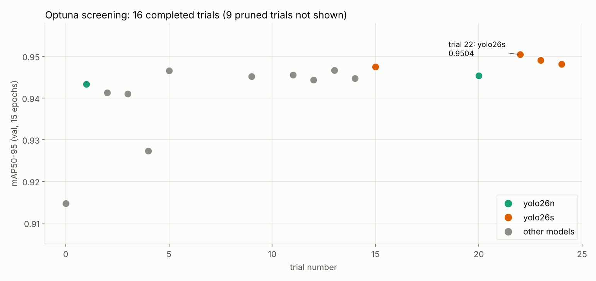
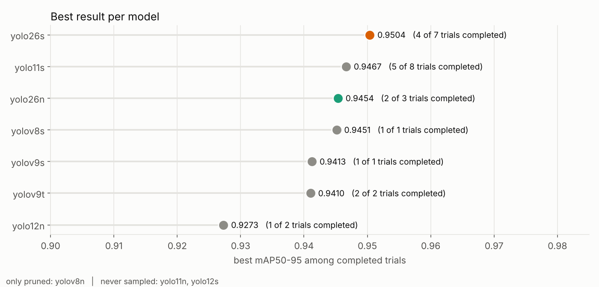
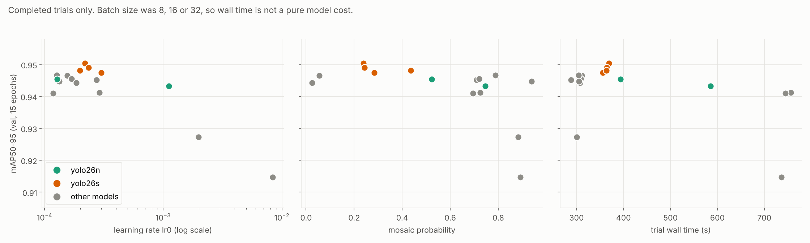
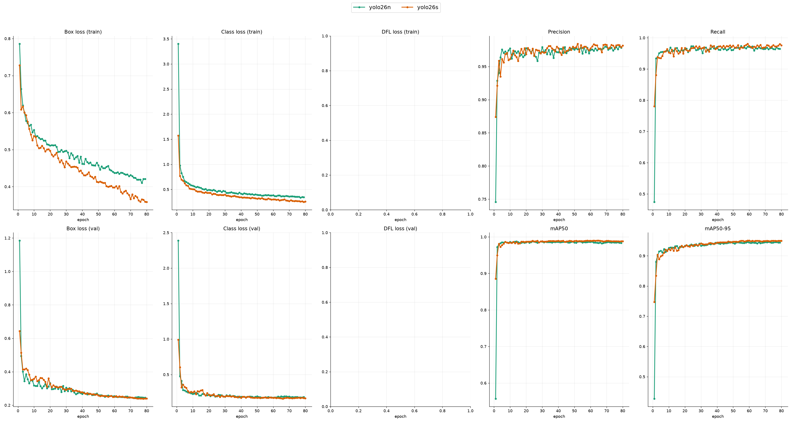
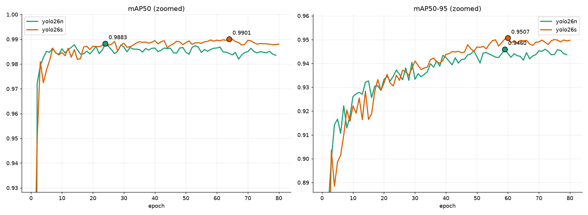
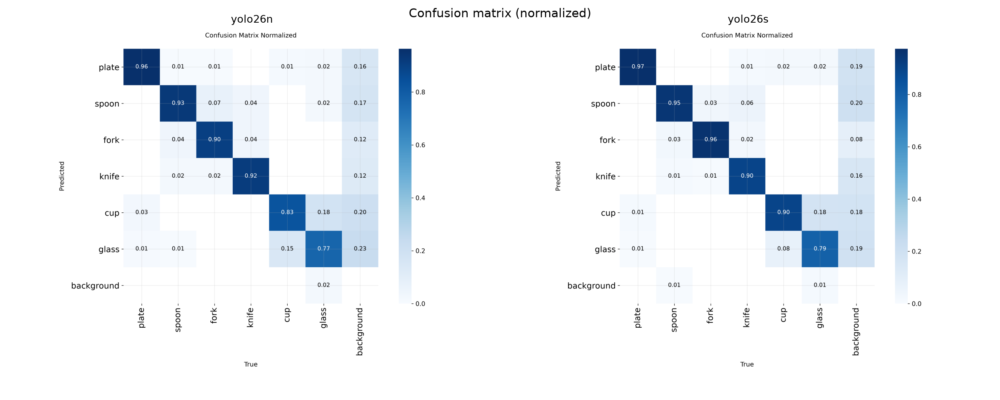
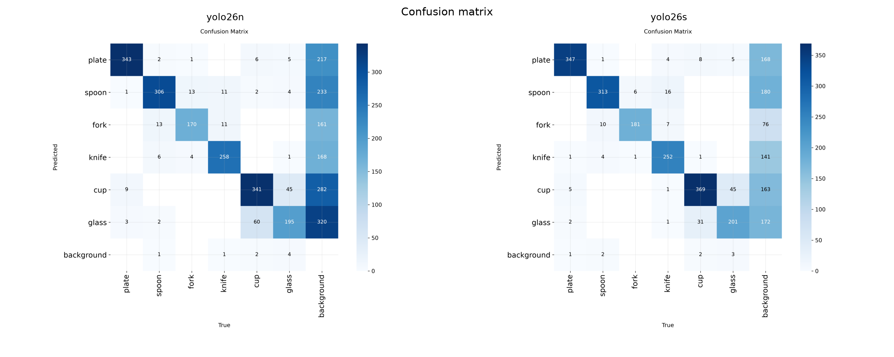
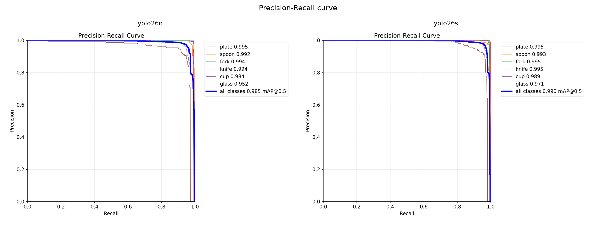
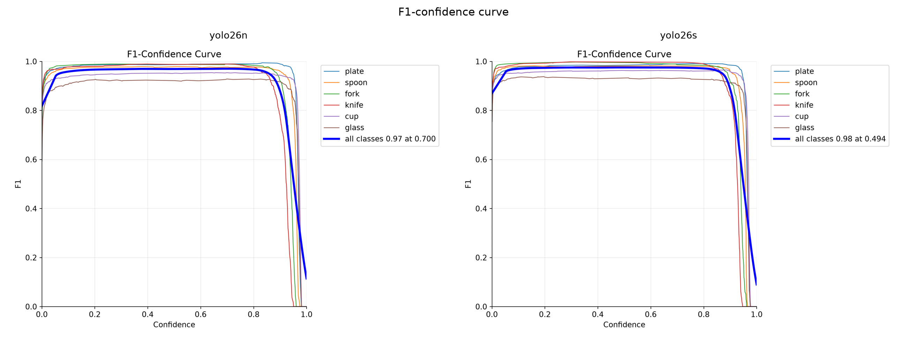
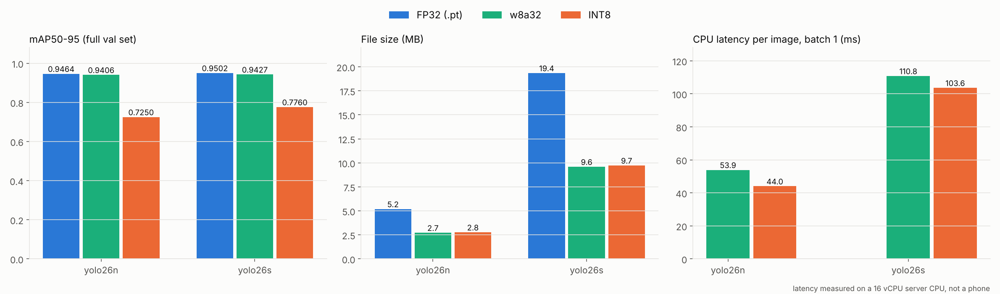

# Wareye
yolo model on mobile app

End-to-end project: **data → annotation → model selection → training → export for Android → app.** Detection classes: `plate, spoon, fork, knife, cup, glass`.

- **GitHub:** wareye
- **Kaggle dataset:** https://www.kaggle.com/datasets/raunakgola/kitchenware-object-detection-dataset-yolo-format

**Documentation**

- [Training concepts and interview notes](docs/training_concepts.md): mosaic, mixup, weight decay and the cosine schedule with plots, plus AdamW, IoU and mAP, NMS, quantization and likely questions
- [Training arguments explained](docs/training_arguments.md): what every argument does (mosaic, mixup, close_mosaic, patience, ...) and the value used in each stage
- [Export and quantization formats](docs/export_and_quantization.md): FP32 vs w8a32 vs static INT8, calibration, and which one to use

**Contents**

1. [Data Annotation](#1-data-annotation-step)
2. [Model Selection: Optuna Screening](#2-model-selection-optuna-screening)
3. [Final Training: YOLO26n vs YOLO26s](#3-final-training-yolo26n-vs-yolo26s)
4. [Export and Quantization for Android](#4-export-and-quantization-for-android)
5. [Reproducing the Results](#5-reproducing-the-results)
6. [Limitations](#6-limitations)
7. [Android App](#7-android-app)

## Repository Structure

```
Wareye/
├── README.md
├── LICENSE
├── .gitignore
├── .gitattributes
│
├── Data_Annotation/                       # Section 1: labelling pipeline
│   ├── Auto_Annotate_Grounding_DINO.ipynb #   round 1: Grounding DINO bootstrap labels
│   ├── train__yolo_and_label_all.ipynb    #   round 2: train the seed model, label the rest
│   ├── app.py                             #   Streamlit box editor
│   ├── train_val_split.py                 #   stratified 85/15 split
│   ├── kitchenware.yaml                   #   dataset config for the seed model
│   └── runs/yolov8s_seed/                 #   seed model run: args, results.csv, curves (no weights)
│
├── Optuna_Screening/                      # Section 2: model selection
│   ├── optuna.ipynb
│   ├── results/                           #   optuna_screening_results_final.csv
│   ├── plots/                             #   3 plots used in this README
│   └── trials/trial_0 ... trial_24/       #   args.yaml + results.csv per trial
│
├── Final_Training_YOLO26/                 # Sections 3 and 4: training and export
│   ├── yolo26_kitchenware.ipynb           #   training, LiteRT export, validation
│   ├── kitchenware.yaml
│   ├── requirements.txt                   #   frozen environment of the final run
│   ├── plots/                             #   yolo26n vs yolo26s comparison plots
│   ├── yolo26n/                           #   best.pt, args.yaml, results.csv, plots/
│   └── yolo26s/
│       ├── best.pt, args.yaml, results.csv, plots/
│       └── exports/                       #   LiteRT files of BOTH models + comparison.csv
│           ├── yolo26n_w8a32.tflite       #     <- the model shipped in the app
│           ├── yolo26n_INT8.tflite
│           ├── yolo26s_w8a32.tflite
│           ├── yolo26s_INT8.tflite
│           └── comparison.csv             #     mAP, size, latency of every format
│
├── docs/
│   ├── training_arguments.md
│   ├── training_concepts.md
│   ├── export_and_quantization.md
│   └── images/                            #   plots and diagrams used by the docs
│
└── Android_App/                           # Section 7: the Kotlin app
    ├── README.md                          #   app guide: use, build, how it works, rebrand
    ├── CHANGES.md                         #   technical change log
    ├── settings.gradle.kts, build.gradle.kts, gradle.properties
    ├── gradlew, gradlew.bat, gradle/wrapper/
    ├── docs/
    │   ├── screenshots/                   #   8 app screenshots used in the READMEs
    │   └── demo/wareye_demo.mp4           #   screen recording of the app
    └── app/
        ├── build.gradle.kts, proguard-rules.pro
        └── src/main/
            ├── AndroidManifest.xml
            ├── assets/model.tflite        #   yolo26n w8a32, same file as in exports/
            ├── java/com/raunak/wareye/    #   14 Kotlin files
            └── res/                       #   layouts, colors, vector icons, strings
```

The app copies `Final_Training_YOLO26/yolo26s/exports/yolo26n_w8a32.tflite` into its `assets/` folder as `model.tflite`, so the app builds on its own.

## 1. Data Annotation Step

This section covers the data and annotation stage.

## Annotation Pipeline

Two rounds of bootstrap-label-then-review instead of labeling ~9,000 images by hand.

**Round 1 — Seed set (900 images, stratified 150/class)**

<div align="center">

| Step | Tool | Time |
|---|---|---|
| Zero-shot auto-label | Grounding DINO | 10 min |
| Review & correct | Custom Streamlit box editor | 1 hr |
| Manual label of gaps | X-AnyLabeling | 25 min |

</div>

**Round 2 — Train seed model → auto-label the rest**

Seed set trained a YOLOv8s active-learning model, used only to pre-label the remaining ~8,500 images faster than manual/zero-shot labeling — not the final production model.

<div align="center">

| Step | Time |
|---|---|
| Train (70 epochs) + auto-label rest | 36 min (31 min training) |

| Class | mAP50 | mAP50-95 |
|---|---|---|
| all | 0.995 | 0.981 |
| plate / spoon / fork | 0.995 | 0.993 / 0.989 / 0.967 |
| knife / cup / glass | 0.995 | 0.958 / 0.989 / 0.990 |

</div>

> Measured on the seed set itself, not a held-out split — an optimistic number, expected here since this model's only job was labeling, not deployment. Every prediction it made was still human-reviewed in Round 3.

**Round 3 — Review active-learning labels (9,445 images)**

<div align="center">

| Step | Time |
|---|---|
| Review, correct, remove bad labels | 5 hr |

</div>

Some images (e.g. bowls mislabeled as plate) were removed rather than corrected to avoid teaching false visual similarities. **Final: 8,984 images.**

## Final Class Distribution

<div align="center">

| Class | Instances | % |
|---|---|---|
| cup | 2,047 | 22.5% |
| plate | 1,801 | 19.8% |
| spoon | 1,658 | 18.2% |
| knife | 1,407 | 15.5% |
| glass | 1,252 | 13.8% |
| fork | 928 | 10.2% |

</div>

~2.2× imbalance, fork smallest and most visually confusable with spoon/knife.

## Dataset Structure

```
dataset/
├── train/{images, labels, classes.txt}
└── val/{images, labels, classes.txt}
```

Standard YOLO format: `class_id x_center y_center width height`, normalized 0–1, one `.txt` per image (empty if no objects). Train/val split (85/15) stratified by each image's primary class: **7,187 train / 1,797 val images**.

## Time Investment

<div align="center">

| Stage | Time |
|---|---|
| Bootstrap + review + gap-fill (seed) | ~1.6 hr |
| Train seed model + auto-label rest | 36 min |
| Review active-learning labels | 5 hr |
| **Total** | **~7 hr** |

</div>

## Tools Built

- **Streamlit box editor** — keep/delete boxes, fix wrong class labels, auto-queue unlabeled images, jump-to-image, auto-advance (pauses on multi-object images)
- Stratified sampling, dataset integrity checks, renumbering, and stratified train/val split scripts

## 2. Model Selection: Optuna Screening

Instead of picking a model by habit, 10 candidate detectors were screened with a short Optuna search. The goal was to find which model and which learning rate / mosaic setting give the best accuracy for the cost, before spending GPU hours on long runs.

Notebook: [`Optuna_Screening/optuna.ipynb`](Optuna_Screening/optuna.ipynb) · Results: [`optuna_screening_results_final.csv`](Optuna_Screening/results/optuna_screening_results_final.csv) · Per-trial logs: [`Optuna_Screening/trials/`](Optuna_Screening/trials) · Argument reference: [`docs/training_arguments.md`](docs/training_arguments.md)

### Setup

<div align="center">

| Item | Value |
|---|---|
| Sampler | Optuna `TPESampler` (Bayesian optimization) |
| Pruner | `MedianPruner(n_warmup_steps=5)` |
| Trials | 25 (16 completed, 9 pruned) |
| Epochs per trial | 15, `patience=15`, `imgsz=640`, AdamW |
| Objective | mAP50-95 on the validation set (1,797 images) |
| Data loading | `cache="disk"`, `workers=12`, dataset on local disk |

| Searched parameter | Range |
|---|---|
| `model` | yolo26n, yolo26s, yolo12n, yolo12s, yolo11n, yolo11s, yolov9t, yolov9s, yolov8n, yolov8s |
| `lr0` | 1e-4 to 1e-2 (log scale) |
| `batch` | 8, 16, 32 (capped for 24 GB VRAM) |
| `mosaic` | 0.0 to 1.0 |

</div>

### Hardware and Time

<div align="center">

| | Optuna screening | Final training + export |
|---|---|---|
| Platform | RunPod | RunPod |
| GPU | RTX 4090, 24 GB | RTX 4090, 24 GB |
| CPU | AMD Ryzen Threadripper 7960X (24 cores) | AMD EPYC 7452 (16 vCPU) |
| RAM | 77 GiB | 94 GB |
| Container disk | 30 GB | 30 GB |
| Software | Python 3.12.3, torch 2.8.0+cu128, Ultralytics 8.4.177, Optuna 5.0.0 | Python 3.12.3, torch 2.8.0+cu128, Ultralytics 8.4.177, litert-torch 0.9.4, ai-edge-litert 2.2.0, torchao 0.17.0 |

| Time and cost | Optuna screening | Final training + export |
|---|---|---|
| Pod uptime (billed) | 2 h 58 min | 2 h 12 min |
| Compute time | 2 h 23 min (25 trials) | yolo26n training 25 min, yolo26s training 40 min, conversion and validation 24.6 min |
| Pod rate | $0.89 / h | $0.89 / h |
| **Cost (USD)** | **$2.64** | **$1.96** |
| **Cost (INR)** | **about ₹252** | **about ₹187** |

Pod uptime is longer than compute time because it also covers setup, dataset download and idle time while the pod was running. Cost is pod uptime × rate, so the whole project came to about $4.60 (about ₹438). INR uses 1 USD = ₹95.32 (14 Oct 2026) and will drift with the exchange rate. RunPod's container-disk billing is not included.

| Optuna run | Time |
|---|---|
| Total wall time (25 trials) | 2 h 23 min |
| Spent on the 9 pruned trials | 30 min |
| One completed trial | 4.8 to 12.6 min (depends on model and batch size) |

</div>

### Results

<div align="center">

| Model | Trials (completed) | Best mAP50-95 | Best trial |
|---|---|---|---|
| **yolo26s** | 7 (4) | **0.9504** | #22 |
| yolo11s | 8 (5) | 0.9467 | #13 |
| yolo26n | 3 (2) | 0.9454 | #20 |
| yolov8s | 1 (1) | 0.9451 | #9 |
| yolov9s | 1 (1) | 0.9413 | #2 |
| yolov9t | 2 (2) | 0.9410 | #3 |
| yolo12n | 2 (1) | 0.9273 | #4 |
| yolov8n | 1 (0) | pruned | #8 |
| yolo11n, yolo12s | never sampled | | |

| Best trial per finalist | batch | lr0 | mosaic | mAP50-95 | mAP50 | GPU inference (ms)* |
|---|---|---|---|---|---|---|
| yolo26s (#22) | 32 | 0.000218 | 0.238 | 0.9504 | 0.9899 | 0.86 |
| yolo26n (#20) | 16 | 0.000128 | 0.523 | 0.9454 | 0.9895 | 0.39 |

</div>

<sub>\* GPU timing from `model.val()` during the search. Indicative only, because it is measured with different batch sizes.</sub>

<p align="center">
  
</p>

<p align="center">
  
</p>

<p align="center">
  
</p>

**What the search showed**

- yolo26s had the best score (0.9504). yolo26n scored 0.9454, 0.005 lower, and had the lowest GPU inference time of the completed trials (0.39 ms, indicative).
- The two trials with `lr0` of 2e-3 or more scored lowest (0.9147 and 0.9273). Every completed trial above 0.944 mAP50-95 used `lr0` between 1.2e-4 and 3.1e-4.
- All four completed yolo26s trials used `mosaic` of 0.44 or lower. With only four trials this is a pattern to note, not a conclusion.
- Decision: train **both** yolo26n and yolo26s to convergence, then compare them after export (Section 3 and 4), instead of choosing from 15-epoch scores alone.

## 3. Final Training: YOLO26n vs YOLO26s

Notebook: [`Final_Training_YOLO26/yolo26_kitchenware.ipynb`](Final_Training_YOLO26/yolo26_kitchenware.ipynb) · Run folders: [`yolo26n/`](Final_Training_YOLO26/yolo26n), [`yolo26s/`](Final_Training_YOLO26/yolo26s)

Both models were fine-tuned from the COCO-pretrained `yolo26n.pt` / `yolo26s.pt` weights for up to 150 epochs with early stopping.

<div align="center">

| Setting | yolo26n | yolo26s |
|---|---|---|
| Parameters | 2,390,950 | 9,467,502 |
| GFLOPs | 5.4 | 20.8 |
| Batch size | 64 | 48 |
| `lr0` | 0.0002 | 0.000218 |
| `mosaic` | 0.52 | 0.238 |
| Epochs (max / completed) | 150 / 79 (early stop) | 150 / 80 (early stop) |
| Best epoch | 59 | 60 |
| **Training time** | **about 25 min** (0.42 h) | **about 40 min** (0.66 h) |

| Shared setting | Value |
|---|---|
| Optimizer | AdamW, cosine learning-rate schedule, weight decay 0.0005 |
| Augmentation | `close_mosaic=12` (never reached, see [Training Concepts](docs/training_concepts.md#mosaic-augmentation)), `mixup=0.1` |
| Early stopping | `patience=20` (both runs stopped 20 epochs after their best epoch) |
| Image size | 640 |
| Data loading | `cache="ram"`, `workers=12` |
| Checkpoints | `save_period=10` |

</div>

Every argument is explained in [`docs/training_arguments.md`](docs/training_arguments.md). The ideas behind them (mosaic, mixup, weight decay, cosine schedule, mAP, quantization), with plots, are in [`docs/training_concepts.md`](docs/training_concepts.md).

### Training Curves

Both models in one figure. Solid lines with markers are the per-epoch results.

<p align="center">
  
</p>

<p align="center">
  
</p>

### Confusion Matrices, PR and F1 Curves

<p align="center">
  
</p>

<p align="center">
  
</p>

<p align="center">
  
</p>

<p align="center">
  
</p>

## 4. Export and Quantization for Android

Both models were exported to LiteRT (`.tflite`) from `best.pt` in two quantized formats and compared with the original weights, always on the **full 1,797-image validation set**.

<div align="center">

| Format | Weights | Activations | Calibration | Intended runtime |
|---|---|---|---|---|
| FP32 (`.pt`) | float | float | none | reference |
| `w8a32` (dynamic) | int8 | float32 | none | phone GPU delegate |
| Static INT8 (`quantize=8`) | int8 | int8 | 629 images (35% of the val split) | CPU / NPU |

</div>

Details and reasoning (how a float becomes an int8, how calibration works, why `w8a32` beats INT8, whether QAT would help, and what the export does about NMS) are in [`docs/export_and_quantization.md`](docs/export_and_quantization.md).

### Results

<div align="center">

| Model | Format | mAP50 | mAP50-95 | Precision | Recall | Drop vs FP32 | Size (MB) | Latency (ms)* |
|---|---|---|---|---|---|---|---|---|
| yolo26n | FP32 (.pt) | 0.9851 | 0.9464 | 0.9766 | 0.9634 | 0 | 5.19 | 0.63 (GPU) |
| yolo26n | **w8a32** | 0.9848 | **0.9406** | 0.9742 | 0.9678 | 0.0058 | **2.72** | 53.9 |
| yolo26n | INT8 | 0.9381 | 0.7250 | 0.9114 | 0.9632 | 0.2214 | 2.77 | 44.0 |
| yolo26s | FP32 (.pt) | 0.9895 | 0.9502 | 0.9773 | 0.9739 | 0 | 19.35 | 1.03 (GPU) |
| yolo26s | w8a32 | 0.9891 | 0.9427 | 0.9751 | 0.9781 | 0.0076 | 9.59 | 110.8 |
| yolo26s | INT8 | 0.9651 | 0.7760 | 0.9242 | 0.9630 | 0.1743 | 9.73 | 103.6 |

</div>

<sub>\* Per-image inference time. The `.pt` rows ran on the RTX 4090 with batch 32; the `.tflite` rows ran on the 16 vCPU server CPU with batch 1. Use them to compare models with each other, not to predict phone speed.</sub>

<sub>Size of the FP32 rows is the `.pt` checkpoint, which Ultralytics saves with FP16 weights. A float32 `.tflite` would be about 9.6 MB (yolo26n) and 38 MB (yolo26s). The exports return raw boxes (`nms=None`), so the app applies the confidence filter and NMS; see [`docs/export_and_quantization.md`](docs/export_and_quantization.md#9-nms-and-the-export).</sub>

<p align="center">
  
</p>

### Time: Conversion and Validation

<div align="center">

| Step | yolo26n | yolo26s |
|---|---|---|
| FP32 validation (GPU) | 11 s | 7 s |
| Export `w8a32` | 14 s | 13 s |
| Export static INT8 (including calibration) | 284 s | 508 s |
| Validate `w8a32` (CPU, batch 1) | 118 s | 216 s |
| Validate INT8 (CPU, batch 1) | 99 s | 205 s |
| **Total** | **8.8 min** | **15.8 min** |

</div>

### Which model goes into the app

**yolo26n in `w8a32` format.**

- Accuracy: 0.9406 mAP50-95, only 0.0021 behind yolo26s in the same format (0.9427), and 0.0058 below its own FP32 weights.
- Size: 2.72 MB, 3.5× smaller than yolo26s `w8a32` (9.59 MB).
- Speed: about 2× faster than yolo26s on the same CPU (53.9 ms vs 110.8 ms).
- Static INT8 is not used. It lost 17 to 22 points of mAP50-95 and was only 6% to 18% faster on CPU. The cause was not investigated further, because `w8a32` already meets the goal.

## 5. Reproducing the Results

Everything ran on RunPod with the PyTorch template. Library versions matter here: the exact environment of the final run is frozen in [`Final_Training_YOLO26/requirements.txt`](Final_Training_YOLO26/requirements.txt).

```bash
pip install -r Final_Training_YOLO26/requirements.txt
```

If pip cannot find `torch==2.8.0+cu128`, install it from the PyTorch index first:

```bash
pip install torch==2.8.0 torchvision --index-url https://download.pytorch.org/whl/cu128
```

Known issue: the LiteRT exporter (`litert-torch`) pulls in the newest `torchao`, which needs torch 2.11 or newer and fails with `cannot import name 'ScalingType'` on torch 2.8. Pinning `torchao==0.17.0` fixes it.

Order of the notebooks: `Optuna_Screening/optuna.ipynb`, then `Final_Training_YOLO26/yolo26_kitchenware.ipynb`.

## 6. Limitations

- There is no separate test set. The validation set was used for the Optuna objective, for early stopping and choosing `best.pt`, and as the INT8 calibration pool, so every reported number is somewhat optimistic.
- Each model was trained once, with one seed. A gap of 0.002 mAP between yolo26n and yolo26s is too small to call a real difference.
- The Optuna search is a screening, not an exhaustive search: 25 trials over 10 models, so some models got one trial and two were never sampled. With 15 epochs and the default `close_mosaic=10`, the `mosaic` value only applied to the first 5 epochs.
- `close_mosaic=12` and the cosine learning-rate decay were planned for 150 epochs, but early stopping ended both runs at epoch 79 and 80. Mosaic was therefore never switched off and the learning rate was still about 0.45 x `lr0` at the end (see [Training Concepts](docs/training_concepts.md#cosine-learning-rate-schedule)).
- The latencies in Section 4 were measured on a server (RTX 4090 for `.pt`, 16 vCPU for `.tflite`), not on a phone. The phone readings in Section 7 come from the app's HUD in screenshots, on one phone and one scene, so they show the order of magnitude and are not a benchmark.
- Accuracy was only measured on the validation set. On the phone the model was checked by eye, and the screenshots show it is not perfect at the default settings: some objects are missed and a fork was once boxed as `spoon 35%`. No phone-side accuracy evaluation was done.

## 7. Android App

The app is in [`Android_App/`](Android_App) (Kotlin, XML views, LiteRT). It runs the model from Section 4 on the phone's camera and draws a box around every plate, spoon, fork, knife, cup and glass in real time. Frames never leave the phone: the app has no internet permission.

<p align="center">
  
  
  
  
</p>
<p align="center"><sub>Live scan · threshold sliders · metrics sheet · slow-on-CPU warning. More screenshots are in <a href="Android_App/README.md#screenshots">the app README</a>.</sub></p>

<p align="center"><a href="Android_App/docs/demo/wareye_demo.mp4">Watch the demo video</a></p>

### What it does

- **Same model as Section 4.** `yolo26n_w8a32.tflite` (2,853,647 bytes) is copied into the app as `app/src/main/assets/model.tflite`.
- **GPU first, CPU as fallback.** LiteRT tries the phone's GPU and switches to the CPU if the GPU cannot run the model. The chip on the Home screen shows which one is in use.
- **App-side post-processing.** The model was exported without NMS, so the app decodes the raw `[1, 10, 8400]` output, applies the confidence threshold and the class filter, then runs NMS itself.
- **Class filter before NMS.** You choose which classes to look for; the others cannot suppress or replace the selected ones. The class list (id, label, category, color) is one registry file, so adding classes later does not change the app logic.
- **Live HUD.** FPS, ms per frame, pre / inference / post time, P50 and P95 over the last 100 frames, and the app's RAM.
- **Controls.** Pause and resume, zoom (1x, 2x, 5x or pinch), torch, front and back camera, confidence and IoU sliders.

**Install.** Download the APK from the **Releases** page of this repository and open it on the phone (Android 6.0 or newer, 64-bit ARM). Android asks you to allow installs from your browser or file manager, and Play Protect may show a warning because the app is not from the Play Store. Build instructions, the full usage guide, how the code works and how to rebrand it are in [`Android_App/README.md`](Android_App/README.md).

### Measured on the phone

<div align="center">

| | GPU (7 readings) | CPU (1 reading) |
|---|---|---|
| FPS | 10.4 to 13.7 | 4.4 |
| Total per frame | 71 to 128 ms | 508 ms |
| Inference | 53 to 77 ms | 494 ms |
| Pre-processing | 17 to 48 ms | 13 ms |
| Post-processing | 0.4 to 3.7 ms | 0.5 ms |

</div>

<sub>Read from the HUD in the screenshots, on one phone, with all 6 classes on and objects on a metal plate. One extra GPU reading (7.2 FPS, 286 ms per frame, 252 ms inference) is left out of the ranges. These are single readings, not a controlled benchmark.</sub>

Two things stand out. On this phone the GPU ran inference roughly 6 to 9 times faster than the single CPU reading, which is why the app tries the GPU first. And pre-processing (copy, rotate, letterbox and convert the camera frame, done on the CPU) took about a quarter to almost half of each GPU frame, so it is the next thing to optimize.
