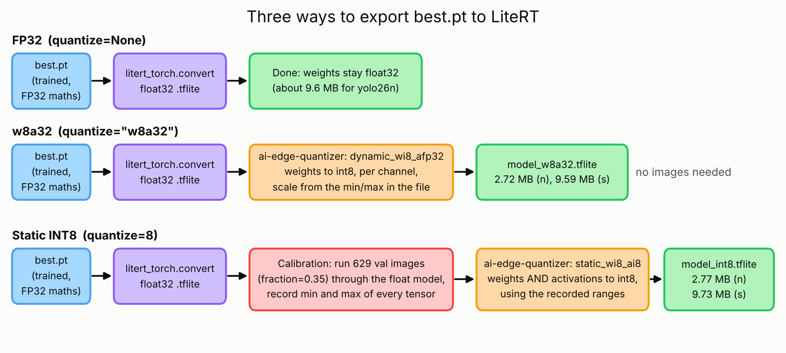
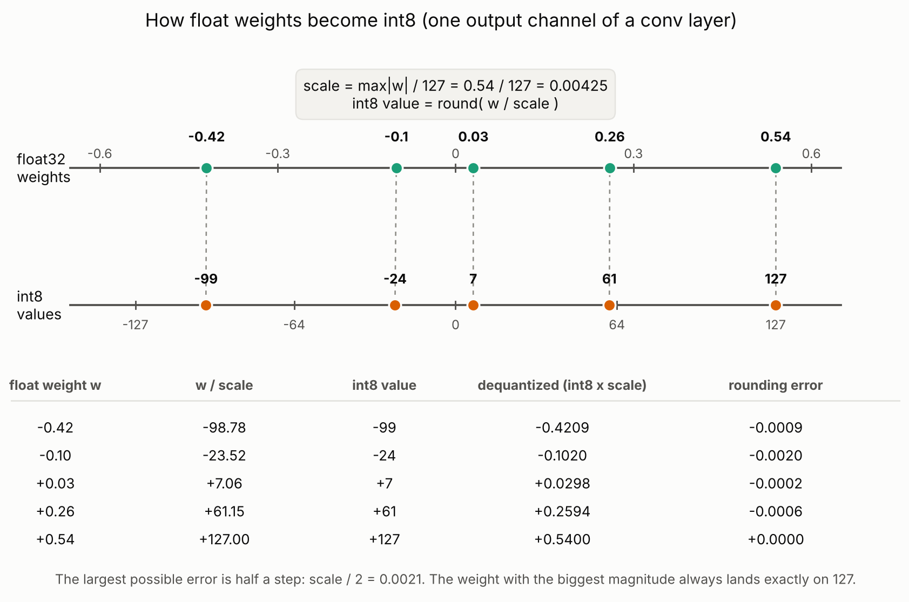
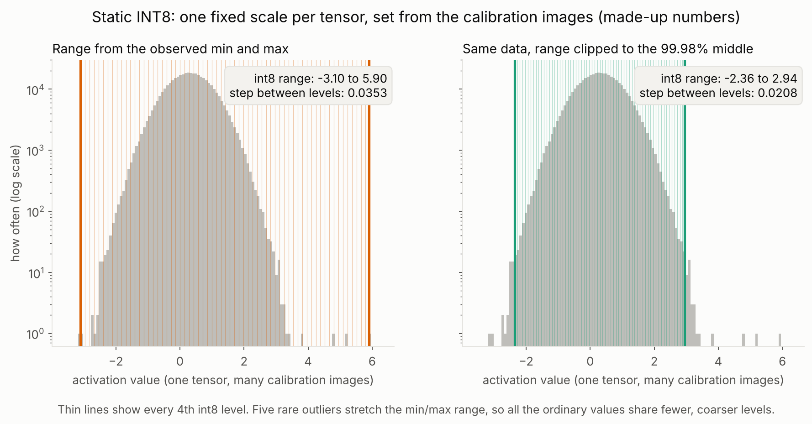

# Export and Quantization

How the trained `best.pt` files became Android-ready `.tflite` models, what each format does to the numbers inside the model, why `w8a32` was chosen, and what the export does and does not include (NMS).

**Contents**

1. [Summary](#1-summary)
2. [The export pipeline](#2-the-export-pipeline)
3. [The formats](#3-the-formats)
4. [How a float becomes an int8 (the w8a32 weights)](#4-how-a-float-becomes-an-int8-the-w8a32-weights)
5. [Why w8a32 needs no calibration](#5-why-w8a32-needs-no-calibration)
6. [How static INT8 calibration works](#6-how-static-int8-calibration-works)
7. [Why w8a32 beats static INT8](#7-why-w8a32-beats-static-int8)
8. [Would quantization-aware training (QAT) fix INT8?](#8-would-quantization-aware-training-qat-fix-int8)
9. [NMS and the export](#9-nms-and-the-export)
10. [Which format when](#10-which-format-when)
11. [Results](#11-results)
12. [Notes for the app](#12-notes-for-the-app)
13. [Troubleshooting](#13-troubleshooting)
14. [References](#14-references)

---

## 1. Summary

- All three formats start from the same trained float model. Quantization is done **after training** (post-training quantization, PTQ). Nothing in this project was trained in int8.
- `w8a32` stores the **weights** as int8 and keeps the **activations** as float32. Weights are fixed numbers in the file, so their range is read straight from the file and no images are needed.
- Static INT8 also rounds the **activations**, whose range depends on the image. Their ranges must be measured by running calibration images through the model.
- Static INT8 lost 17 to 22 points of mAP50-95 here. `w8a32` lost under 1 point and is about 3.5 times smaller than FP32 weights.
- The exports use the default `nms=None`, so the model returns raw candidate boxes and the app has to filter them ([section 9](#9-nms-and-the-export)).

## 2. The export pipeline

  

1. `litert_torch.convert` traces the PyTorch model and writes a float32 `.tflite`.
2. For `w8a32` and INT8, the `ai-edge-quantizer` library then rewrites that file using a *recipe*: `dynamic_wi8_afp32` for `w8a32`, `static_wi8_ai8` for INT8.
3. Only the static recipe needs the calibration step in the red box.

## 3. The formats

| Format | `quantize=` | Weights | Activations | Calibration images | Typical use |
|---|---|---|---|---|---|
| FP32 | `None` or `32` | float32 | float32 | no | accuracy reference; the GPU delegate runs it in FP16 |
| `w8a32` (dynamic INT8) | `"w8a32"` | int8 | float32 in the file | no | **default choice for phones (used here)** |
| `w8a16` | `"w8a16"` | int8 | int16 | yes | integer activations with less rounding than int8 (not tried here) |
| Static INT8 | `8` | int8 | int8 | yes | NPUs and CPUs with int8 kernels |

- **FP16 is not a separate export** for LiteRT. A float32 model runs in FP16 at runtime on the GPU delegate.
- **Weights vs activations.** Weights are fixed numbers stored in the file. Activations are the values each layer produces while the model runs on one specific image.
- **File sizes follow the weights.** Bytes per parameter: float32 is 4, int8 is 1. For yolo26n (2.39 M parameters) that is about 9.6 MB in float32 and about 2.4 MB in int8, plus a little overhead, which matches the 2.72 MB measured.

## 4. How a float becomes an int8 (the w8a32 weights)

This is the whole trick, shown with one small example. A conv layer has several output channels, and each channel has its own list of weights. `w8a32` quantizes **each channel on its own**, using only the numbers already in the file.

  

1. **Find the largest magnitude** in the channel: here `max|w| = 0.54`.
2. **Compute one scale** so that this value maps to 127: `scale = 0.54 / 127 = 0.00425`.
3. **Divide and round**: `int8 = round(w / scale)`. For `0.26` that is `round(61.15) = 61`.
4. **Store** the int8 values plus the one float `scale` for the channel.
5. **At runtime**, a weight is rebuilt as `int8 x scale`: `61 x 0.00425 = 0.2594`, against the original `0.26`.

The mapping is **symmetric**: zero stays exactly zero (zero point 0), and the range is [-max, +max]. The largest possible rounding error is half a step (`scale / 2`, here 0.0021). Because every channel has its own scale, a channel with small weights gets a small, fine step. These are the settings of `dynamic_wi8_afp32` in `ai-edge-quantizer` (channelwise int8 weights with min/max scaling).

The example numbers are made up for illustration. The principle is exact, but real layers have thousands of weights per channel.

## 5. Why w8a32 needs no calibration

Calibration answers the question "what range of values will this tensor have?" For **weights** the answer is already in the file: look at them. For **activations** the answer depends on the input image, so it can only be found by running images through the model.

In `w8a32` the activations are **float32 in the model file**. No activation range is stored, so there is nothing to measure. The quantizer's own description says the float32 activations "will be dynamically quantized to int8 during inference to enable int8 compute" and that quality "may suffer due to the on-the-fly quantization". In other words:

- The file holds int8 weights and a scale per channel, and no activation ranges.
- At runtime, a CPU kernel may measure the min and max of the **actual** input of each layer on that very frame, quantize it on the fly, and do the maths in int8. The range always fits the current image, so no calibration set is needed.
- A GPU delegate typically expands the int8 weights back to float and computes in float. Which path a phone takes depends on the delegate, so measure on the device.

## 6. How static INT8 calibration works

Static INT8 fixes every activation range **before** the model ships, so the phone does no measuring.

  

What the exporter does (from `ultralytics/utils/export/litert.py`):

1. Writes the float32 `.tflite`.
2. Builds a calibration dataloader from the dataset YAML in `data=`, using the split in `split=` (default `val`) and the share of it in `fraction=`. Here `fraction=0.35` gave **629 images**.
3. Feeds each image (scaled to 0 to 1) through the float model and records the **minimum and maximum** of every activation tensor (the `MIN_MAX_UNIFORM_QUANT` algorithm).
4. Turns each recorded range into a `scale` and a `zero point` for that tensor. Activations use an **asymmetric** int8 range, so the zero point is not zero: `scale = (max - min) / 255`, and the zero point shifts the range onto -128 to 127.
5. Quantizes weights (as in section 4) and bakes the activation scales into the model. The model's input and output stay float32.

The figure shows why this is delicate. With the made-up numbers there, five rare outliers set the range to -3.10 to 5.90, so every ordinary value shares steps of 0.035. Clipping the range to the 99.98% middle gives steps of 0.021. A min/max range can only grow as you add more images, because one unusual image stretches it. At runtime, any value outside the stored range is clipped.

Two side effects to know about:
- The validation split was used both for calibration and for evaluation. Only ranges are taken from it, so the leak is small, but it exists.
- Each tensor gets **one** scale for all its channels and positions, unlike the per-channel scales of the weights.

## 7. Why w8a32 beats static INT8

Measured on the full validation set, mAP50-95 was 0.9406 (w8a32) against 0.7250 (INT8) for yolo26n, and 0.9427 against 0.7760 for yolo26s. The reasons below explain why activations are the hard part. They are well-founded but **were not isolated by experiment in this project**.

1. **Weights are easy to round.** They are fixed, they have a known range, and each channel has its own scale. The error per weight is at most half a small step (section 4).
2. **Activations are hard to round.** They change with every image, and one fixed range per tensor has to cover them all. Outliers waste levels (section 6), and a frame that looks unlike the calibration set gets clipped.
3. **In `w8a32` the activation range, when it is quantized at all, comes from the current input**, not from a stored guess.
4. **The detection head is a worst case.** Its output puts 4 box values and 6 class scores into one tensor, and that tensor gets one scale. The exporter has to divide the box values by the image size (so they are 0 to 1, like the scores) just to keep the class scores from collapsing; its code comment says so. Even then an int8 output has only about 255 levels, which is a step of roughly 0.004, or about **2.5 pixels on a 640-pixel input**, for every box coordinate. That is coarse for strict overlap thresholds.
5. **Errors add up.** Every layer rounds its output and passes the error on.

The numbers fit this picture. For static INT8, mAP50 stayed fairly high (0.938 for yolo26n) while mAP50-95 fell far further, so objects were still found but boxes matched the labels less tightly (see the gap plot in [training_concepts.md](training_concepts.md#iou-precision-recall-and-map)).

For scale: the Ultralytics documentation reports a loss of only about 0.01 mAP50-95 for INT8 PTQ of yolo26n on COCO with TensorRT. A loss of 0.17 to 0.22 here is much larger, which points at this specific export path, dataset, or calibration, and not at an unavoidable cost of int8. That difference has not been investigated.

## 8. Would quantization-aware training (QAT) fix INT8?

**First, a correction to the question:** these models were **not trained in int8**. Training was ordinary float training (with mixed precision on the GPU). Quantization was applied afterwards to the finished `best.pt`, which is post-training quantization (PTQ).

**QAT** is different. It fine-tunes the model with *fake quantization* in the loop: each forward pass rounds weights and activations to int8 and passes gradients through the rounding, so the model learns weights and activation ranges that survive int8.

For this project it is not a quick fix:

- **Ultralytics does not export QAT to LiteRT.** Per the export documentation, QAT runs through NVIDIA TensorRT Model Optimizer, `onnx` and `engine` exports keep the learned ranges, and "other formats read calibration instead and reject a QAT checkpoint", which includes LiteRT. A QAT route to `.tflite` would need a different toolchain (for example PyTorch's own quantization training plus `litert-torch`), and that is experimental work.
- **GPU time would be small; engineering time would not.** A rough guess, not measured: your logs show about 19 s per epoch for yolo26n and about 29 s for yolo26s (including validation). Fake quantization often makes epochs 1.5 to 3 times slower. QAT usually needs 10 to 30 epochs, so roughly 5 to 30 minutes for yolo26n and 7 to 45 minutes for yolo26s.
- **It may not be needed.** In the Ultralytics TensorRT table for yolo26n, PTQ INT8 (0.3934) and QAT INT8 (0.3935) are almost the same, against FP32 at 0.4032. QAT helps most when PTQ is badly off, and the first step would be to find out why it is badly off here.

Cheaper things to try before QAT, all untested:
- `quantize="w8a16"`: int8 weights with int16 activations. It has 256 times more activation levels than int8 and is available in the same exporter. It needs calibration data and probably runs on the CPU only.
- Compare `fraction=1.0` (all validation images) with `0.35`. This usually does not remove the outlier problem, because a min/max range only grows.
- Keep using `w8a32`, which already meets the size and accuracy needs.

## 9. NMS and the export

**What NMS is:** a detector proposes many overlapping boxes for the same object. Non-maximum suppression keeps the highest-scoring box and removes the others that overlap it by more than an IoU threshold.

**What was exported here:** the default `nms=None`. In Ultralytics 8.4.177 this sets `model.end2end = False`, which exports YOLO26's raw "one-to-many" head. The output is `(1, 10, 8400)`: 8,400 candidate positions with 4 box values and 6 class scores each. These candidates are **not** filtered, so the app must do it.

| `nms=` | What the exporter does | Output | NMS in the app? |
|---|---|---|---|
| `None` (default, **used here**) | raw one-to-many head | `(1, 10, 8400)` | **yes**, plus a confidence filter |
| `False` | switches to YOLO26's NMS-free end-to-end head (one-to-one) | `(1, 300, 6)` as `[x1, y1, x2, y2, conf, class]` | no, only a confidence cutoff |
| `True` | LiteRT cannot embed NMS, so the exporter warns and falls back to `None` | same as default | yes |

Things to know about each option:

- **LiteRT does not accept `nms=True`.** Its accepted export arguments are `batch`, `quantize`, `data`, `fraction`, `imgsz` and `device`. NMS cannot be baked into the file the way it can for ONNX or TensorRT.
- **`nms=False` is the way to avoid app-side NMS**, and it is accepted for LiteRT. It is **not** available for static INT8 (`quantize=8` or `"w8a16"`): the exporter switches the end-to-end head off there with a warning, because static activation quantization "collapses the end2end class-index output".
- **`nms=False` has not been tried on these models.** It needs a new export and a new validation run to confirm the converter handles the top-k step and that accuracy matches. The `nms=None` files are the ones measured in this repository.

What the app has to do with the default export:
1. Read each of the 8,400 columns: the 6 class scores are the last 6 of the 10 channels.
2. Take the best class and its score. Drop the candidate if the score is under the confidence threshold (Ultralytics defaults to 0.25).
3. Convert the box from center format `(cx, cy, w, h)` to corners and scale it back to the camera frame, undoing any letterbox padding.
4. Run NMS per class with an IoU threshold (Ultralytics defaults to 0.7) and keep at most a few hundred boxes.

## 10. Which format when

| Situation | Pick |
|---|---|
| Phone app, small file, near-float accuracy (this project) | `w8a32` |
| You need the highest accuracy and file size is not a concern | FP32 `.tflite` (GPU delegate runs it in FP16) |
| Integer-only hardware (NPU or DSP) that needs int8 or int16 tensors | static INT8 or `w8a16`, with calibration data that looks like the real camera feed, validated on the device |
| You want to avoid NMS code in the app | try `nms=False` with FP32 or `w8a32` (not INT8) |
| INT8 accuracy is bad and you cannot explain it | check the calibration set first, then try `w8a16`; QAT is the last resort |

## 11. Results

See the full table in the main [README](../README.md#4-export-and-quantization-for-android). In short, on the full 1,797-image validation set:

| Model | Format | mAP50-95 | Size (MB) |
|---|---|---|---|
| yolo26n | FP32 (`.pt`, weights stored as FP16) | 0.9464 | 5.19 |
| yolo26n | w8a32 | 0.9406 | 2.72 |
| yolo26n | INT8 | 0.7250 | 2.77 |
| yolo26s | FP32 (`.pt`, weights stored as FP16) | 0.9502 | 19.35 |
| yolo26s | w8a32 | 0.9427 | 9.59 |
| yolo26s | INT8 | 0.7760 | 9.73 |

`w8a32` costs 0.6 to 0.8 points of mAP50-95. The "FP32" rows are the `.pt` checkpoints, and Ultralytics saves those with **FP16 weights**, which is why they are not twice the size of `w8a32`. A real float32 `.tflite` would be about 9.6 MB (yolo26n) and 38 MB (yolo26s), so `w8a32` is about 3.5 to 4 times smaller than float32 weights, and about 2 times smaller than the `.pt`. Static INT8 was not smaller than `w8a32` (2.77 against 2.72 MB), because both store int8 weights.

## 12. Notes for the app

- **Box values may be fractions, not pixels.** For non-end-to-end exports, the exporter divides the 4 box channels by the input size (640) before the model output, and Ultralytics' own runtime multiplies them back. The `.tflite` output you read in Kotlin is therefore probably 0 to 1 for the box channels. Print the raw output for one test frame and check before wiring the box drawing. This is read from the exporter source and has not been checked on the exported files.
- **Check the real tensor shapes** (Netron, or the interpreter's tensor details) before wiring the app. The layout may differ from PyTorch's `(1, 10, 8400)`, for example transposed to `(1, 8400, 10)`.
- **Input:** 640 x 640 RGB scaled to 0 to 1, resized the same way as in validation (letterboxed, not stretched).
- **Speed:** all timings in this repository come from a server, not a phone. Measure on the device, with the delegate you plan to ship.
- Batch size does not change file size, and for live video the app runs one frame at a time (batch 1).

## 13. Troubleshooting

- `ImportError: cannot import name 'ScalingType' from 'torch.nn.functional'` during export: `litert-torch` installed a `torchao` that needs torch 2.11 or newer. With torch 2.8.0, run `pip install "torchao==0.17.0"` and restart the kernel.
- Ultralytics may try to auto-install `litert-torch` and `ai-edge-litert` the first time you export. Install `ultralytics[export-litert]` up front instead (see `requirements.txt`).
- INT8 export asks for calibration data: pass `data=` (the dataset YAML) and, if you want less than the full split, `fraction=`.

## 14. References

- Ultralytics, [Model Export](https://docs.ultralytics.com/modes/export): export arguments, the `quantize` values, LiteRT, calibration (`data`, `split`, `fraction`), QAT, and the `nms` argument.
- Ultralytics Platform, [Train: Models](https://docs.ultralytics.com/platform/train/models): export formats and per-format precision and NMS notes. It states, for example, that "Classification, semantic segmentation, and depth exports do not include NMS" and that post-processing is configurable only where the format supports it.
- Ultralytics 8.4.177 source (the version used here): `ultralytics/engine/exporter.py` (format table, `nms` and `end2end` handling), `ultralytics/utils/export/litert.py` (the `w8a32`, `w8a16` and INT8 recipes and the calibration loop) and `ultralytics/utils/export/engine.py` (box normalization).
- `ai-edge-quantizer` recipes: `dynamic_wi8_afp32` (channelwise symmetric int8 weights) and `static_wi8_ai8` (int8 weights and int8 activations, calibration needed).
