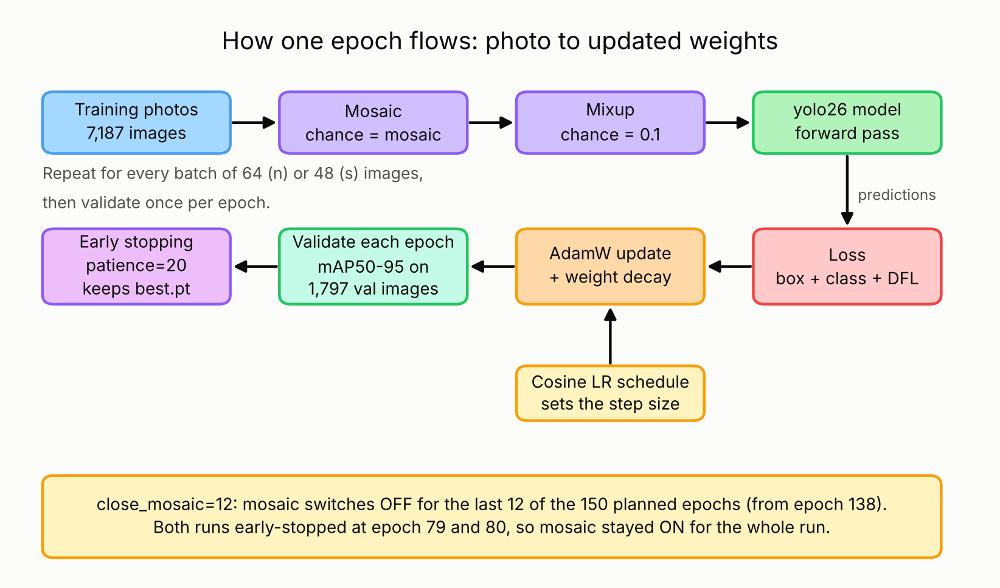
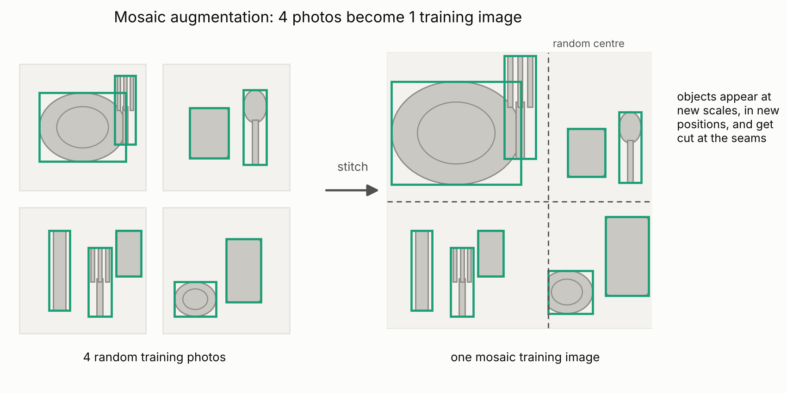
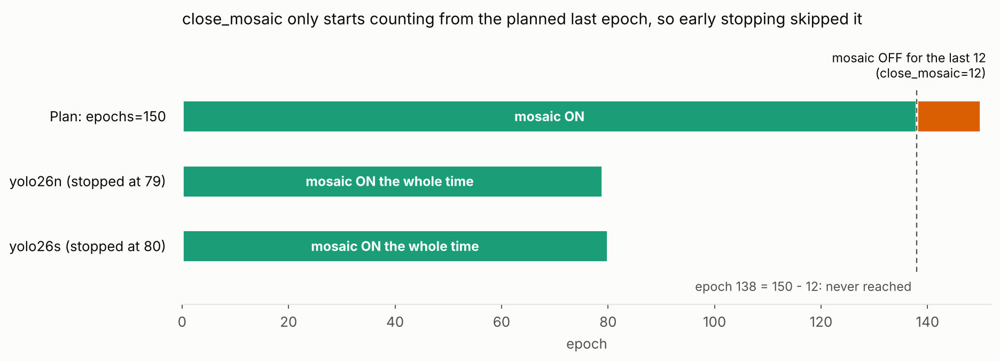
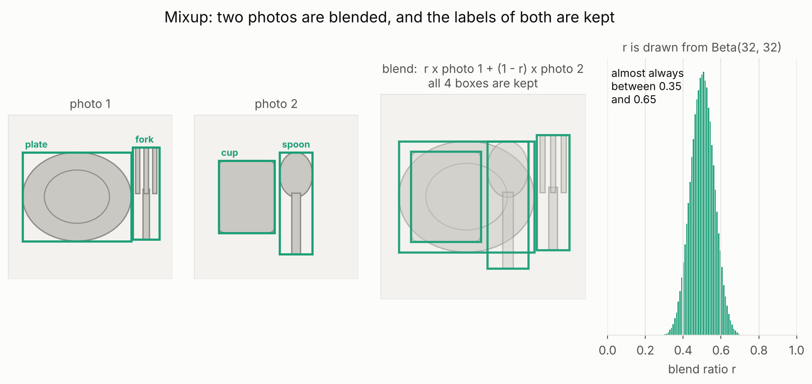
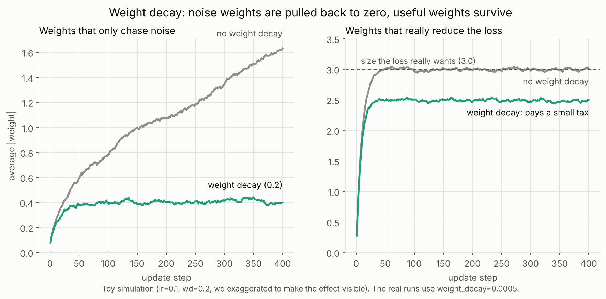
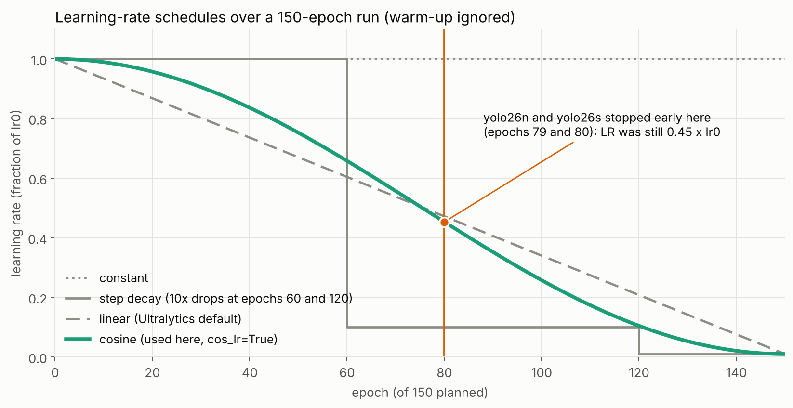
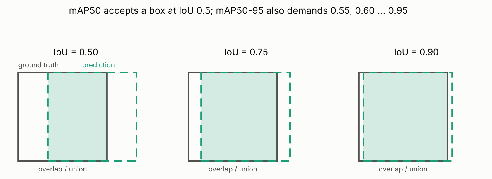
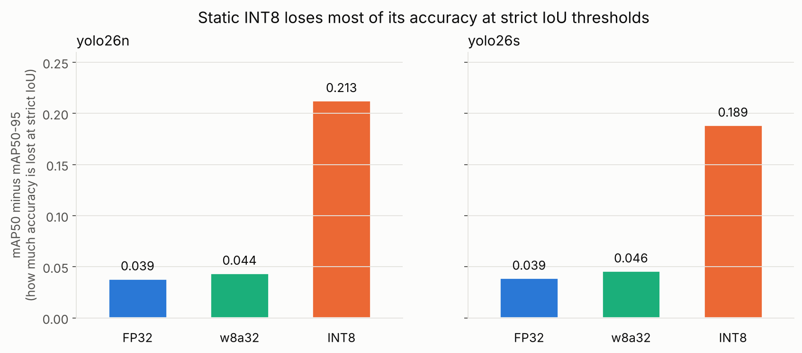

# Training Concepts

What the knobs in `model.train(...)` actually do, what they did in these runs, and the wider concepts behind the project (written so they can be explained out loud in an interview). Part 1 explains the four knobs most worth understanding, with plots. Part 2 covers the concepts around them. Part 3 lists what to change next time and likely questions.

For the exact value of every argument, see [`training_arguments.md`](training_arguments.md).

**Contents**

1. The training knobs
    - [Mosaic augmentation](#mosaic-augmentation)
    - [Mixup](#mixup)
    - [Weight decay](#weight-decay)
    - [Cosine learning-rate schedule](#cosine-learning-rate-schedule)
2. Concepts behind the project
    - [Transfer learning and fine-tuning](#transfer-learning-and-fine-tuning)
    - [AdamW and the learning rate](#adamw-and-the-learning-rate)
    - [Warm-up](#warm-up)
    - [Batch size](#batch-size)
    - [Early stopping, patience and overfitting](#early-stopping-patience-and-overfitting)
    - [IoU, precision, recall and mAP](#iou-precision-recall-and-map)
    - [Confidence threshold and NMS](#confidence-threshold-and-nms)
    - [Hyperparameter search with Optuna](#hyperparameter-search-with-optuna)
    - [Quantization](#quantization)
    - [Validation vs test data](#validation-vs-test-data)
3. Lessons and quick answers
    - [What I would change next time](#what-i-would-change-next-time)
    - [Likely questions, short answers](#likely-questions-short-answers)

  

---

## Part 1: The training knobs

### Mosaic augmentation

Instead of training on one photo at a time, **mosaic** stitches 4 random training images together into a single collage, then trains on that. Objects end up at unfamiliar scales and positions, and often cut off at the seams. This forces the model to recognize a fork whether it is huge, tiny, in a corner, or half out of frame. It cannot get away with memorizing "forks are usually centered and this big."

Ultralytics enables mosaic by default (`mosaic=1.0`, meaning every image) and **turns it off for the last `close_mosaic` epochs** (default 10, here 12). Training on collages right up to the end can leave the model slightly mismatched to real, single, un-stitched photos, so the last epochs use normal images.

  

**What happened here:** `mosaic` was searched by Optuna (0.52 for yolo26n, 0.238 for yolo26s). `close_mosaic` counts back from the *planned* last epoch (150 - 12 = epoch 138). Both runs early-stopped at epoch 79 and 80, so mosaic was never switched off and the models never saw a "clean" finishing phase.

  

### Mixup

**Mixup** blends two entire images together (a soft, semi-transparent overlay). Both images' boxes are kept, so the model has to find all four objects in the blended picture. The blend ratio is drawn from a Beta(32, 32) distribution, so it is almost always close to 50/50. It is a gentler, statistical form of regularization: it discourages the model from drawing overly sharp, brittle decision boundaries and nudges it toward smoother ones that generalize better to slightly different looking inputs.

`mixup=0.1` is the *probability* of applying it to a training image, so only about 1 image in 10 is blended. That is deliberately low: the dataset has 6 classes and 7,187 training images, and too much mixup on a dataset this size makes training noisier than it needs to be.

  

### Weight decay

**Weight decay** is a small constant "tax" taken from every weight on every update, independent of the gradient. Left unchecked, a network can grow a few very large weights that memorize quirks of the training set (overfitting). Weight decay continuously nudges all weights back toward zero, so only weights that earn their size by consistently reducing the loss stay large. Everything else shrinks away. It is the difference between a model that finds a few generalizable patterns and one that mostly memorizes.

Here `weight_decay=0.0005` with the AdamW optimizer. AdamW applies the decay *directly to the weights* instead of mixing it into the gradient, which is why it is called "decoupled" weight decay and why it behaves better than plain L2 regularization with Adam.

  

### Cosine learning-rate schedule

The **learning rate** controls how big a step the optimizer takes on each update. Start too high for too long and training stays noisy and unstable. Drop it too early and the model gets stuck before finding a good solution. A **cosine schedule** starts the learning rate high and lets it decay along a cosine curve down to `lr0 x lrf` (here 1% of `lr0`) by the last planned epoch. Early on it takes large, exploratory steps. Late in training it takes small, careful steps. It is smoother than a step-decay schedule, which shocks training with a sudden drop.

  

**What happened here:** the schedule is laid out for 150 epochs, so when early stopping ended the runs at epoch 79 and 80 the learning rate was still about 0.45 x `lr0`. The models never reached the low-LR fine-tuning phase either. They still scored well (mAP50-95 0.946 and 0.950 in FP32), but a shorter plan such as `epochs=90` would have let the cosine curve and `close_mosaic` finish as designed. That is the first thing to change in a next run.

---

## Part 2: Concepts behind the project

### Transfer learning and fine-tuning

**What:** Start from weights already trained on a large dataset (COCO, 80 classes) instead of random weights, then continue training on your own data.

**Why it matters here:** The early layers already detect edges, textures and shapes, which every object detector needs. Only the last layers have to learn "plate, spoon, fork, knife, cup, glass". That is why a 7,187-image dataset reaches mAP50-95 above 0.94 in 60 epochs or so.

**Detail:** Here every layer was trained (no frozen layers) with a small learning rate (`lr0` around 0.0002), so the pretrained knowledge is adjusted, not overwritten. A large learning rate on a pretrained model can destroy what it already knows.

### AdamW and the learning rate

**Adam** keeps a running average of each weight's gradient and of its square, and gives every weight its own step size. **AdamW** is Adam with *decoupled* weight decay: the decay is applied straight to the weights instead of being added to the gradient. With plain Adam plus L2 the penalty gets rescaled by the adaptive step size, which makes it weaker for weights with large gradients. AdamW avoids that.

**Why the learning rate is small:** AdamW fine-tuning works best around 1e-4 to 1e-3, while Ultralytics' default SGD setting uses 0.01. The Optuna search found 0.0001 to 0.0003 best for yolo26n and yolo26s, in line with that.

**Detail worth knowing:** Ultralytics scales `weight_decay` by `batch x accumulate / nbs` (with `nbs=64`) in its trainer. With batch 64 that factor is 1, and with batch 48 it is 0.75, so yolo26s probably trained with an effective decay of about 0.000375 instead of 0.0005. Check this against your installed version before quoting it.

### Warm-up

For the first few epochs (`warmup_epochs=3` by default) the learning rate starts near zero and rises to `lr0`. Early gradients from a freshly attached detection head are large and noisy, and a full-size step then can damage the pretrained layers. Warm-up lets the new head settle first. The learning-rate plot above ignores it, because it is short compared with 150 epochs.

### Batch size

A batch is how many images the model sees before one weight update. Larger batches give a less noisy gradient and make better use of the GPU, but need more VRAM and give fewer updates per epoch. yolo26n used batch 64 and yolo26s used 48 because the larger model needs more memory per image on the 24 GB RTX 4090.

Batch size and learning rate interact: a common rule is to raise the learning rate when the batch grows. In this project both were searched together by Optuna instead of being fixed by a rule.

### Early stopping, patience and overfitting

**Overfitting** means the training loss keeps going down while validation accuracy stops improving or gets worse, because the model starts memorizing the training set.

`patience=20` stops training when validation fitness (a weighted mix of mAP50 and mAP50-95) has not improved for 20 epochs, and keeps the best checkpoint as `best.pt`. Here the best epochs were 59 and 60, and the runs stopped at 79 and 80.

**Caveat:** the same validation set decides when to stop *and* is used to report results. That makes the reported numbers slightly optimistic (see [Validation vs test data](#validation-vs-test-data)).

### IoU, precision, recall and mAP

- **IoU (intersection over union):** overlap area divided by combined area of the predicted box and the true box. 1.0 is a perfect match.
- **Precision:** of the boxes the model drew, how many were right. **Recall:** of the real objects, how many the model found.
- **AP:** the area under the precision-recall curve for one class. **mAP** is the mean over classes.
- **mAP50:** a detection counts as correct if IoU is at least 0.5. **mAP50-95:** the average of mAP at IoU 0.50, 0.55, ... 0.95, so it also rewards *tight* boxes.

**Where it shows up in this project:** static INT8 kept mAP50 reasonably high (0.938 for yolo26n) but mAP50-95 collapsed to 0.725. The gap between the two metrics grew from about 0.04 (FP32 and w8a32) to 0.19 to 0.21 (INT8). The objects were still being found, but the boxes no longer matched the ground truth as tightly. Quantizing the box-coordinate outputs to 8 bits is a plausible cause, but this was not tested separately.

### Confidence threshold and NMS

A detector outputs many candidate boxes, each with a class score. Two steps turn them into the final list:

1. **Confidence threshold:** drop boxes whose score is below a cutoff. Raising it gives higher precision and lower recall. The F1-confidence curve in the [README](../README.md#confusion-matrices-pr-and-f1-curves) shows where the best balance is.
2. **NMS (non-maximum suppression):** when several boxes cover the same object, keep the highest-scoring one and remove boxes that overlap it by more than an IoU threshold.

The exported `.tflite` models return the raw head output of shape `(1, 10, 8400)`: 8,400 candidate positions, each with 4 box values and 6 class scores. The Android app therefore has to apply the threshold and NMS itself. The reason, the alternatives (`nms=False`), and what the app has to do are in [`export_and_quantization.md`](export_and_quantization.md#9-nms-and-the-export).

### Hyperparameter search with Optuna

Optuna's **TPE sampler** builds two models of "good" and "bad" trials so far and proposes the next trial where good ones are most likely. The **MedianPruner** stops a trial early if its intermediate result is below the median of earlier trials at the same epoch, so the 9 pruned trials used only 30 minutes of the 2 h 23 min run.

**Honest limits:** 25 trials over 10 models is a screening, not a thorough search. Each trial ran only 15 epochs, so the ranking favors models that learn fast, and a few models got just one trial. The final choice between yolo26n and yolo26s therefore rested on a separate, longer training run of both.

### Quantization

Quantization stores numbers in fewer bits so the model is smaller and faster on phones.

| Format | Weights | Activations | Calibration needed |
|---|---|---|---|
| FP32 | 32-bit float | 32-bit float | no |
| `w8a32` | int8 | float32 | no |
| Static INT8 | int8 | int8 | yes |

- **Post-training quantization (PTQ)** converts a finished model, which is what was done here. **Quantization-aware training (QAT)** simulates the rounding during training so the model learns to cope with it. QAT usually recovers more accuracy but costs a new training run.
- **Calibration** is needed only when *activations* are quantized, because their ranges depend on real input data. Weights are fixed numbers, so their range is read straight from the file.
- The result here: `w8a32` cost 0.006 to 0.008 mAP50-95 and made the model about 2 times smaller than the `.pt` file (which stores FP16 weights) and about 3.5 times smaller than float32 weights, while static INT8 lost 0.17 to 0.22 mAP50-95.

Worked examples (float to int8 with min/max, calibration, why `w8a32` beats INT8, and whether QAT would help) are in [`export_and_quantization.md`](export_and_quantization.md).

### Validation vs test data

The validation set is used while building the model (early stopping, picking the best epoch, the Optuna objective, INT8 calibration). Data that influenced those choices cannot give an unbiased final score. A **test set** is data touched only once, at the end.

This project has no separate test set, so every number is somewhat optimistic. The fix is to photograph or collect a fresh set, ideally in kitchens that are not in the training data, and report the final accuracy on it.

---

## Part 3: Lessons and quick answers

### What I would change next time

- **Plan the schedule around the real stopping point.** `epochs=150` with `patience=20` stopped at epoch 79 and 80, so `close_mosaic=12` never started and the cosine learning rate had only decayed to about 0.45 of `lr0`. Using `epochs=90` would let both finish as designed.
- **Run each model with 3 seeds** to know whether the 0.002 mAP gap between yolo26n and yolo26s is real.
- **Hold out a test set** that is never used for any decision.
- **Measure latency on the phone**, not on a server CPU.
- **Try quantization-aware training** or keeping the box head in higher precision if static INT8 is ever needed for an NPU.

### Likely questions, short answers

**Why yolo26n and not yolo26s?** Accuracy is almost the same (w8a32 mAP50-95 0.9406 vs 0.9427), but the model is 3.5 times smaller (2.72 MB vs 9.59 MB) and about 2 times faster on the same CPU.

**Why not static INT8, since it is the "smallest" format?** It was not smaller (2.77 MB vs 2.72 MB) and its mAP50-95 fell to 0.725. `w8a32` is already int8 for the weights, which is where the size comes from.

**Why early stopping at 20 epochs?** It protects against overfitting and saves GPU time. Both runs peaked around epoch 60 and gained nothing in the next 20.

**What does mosaic do and when do you turn it off?** It combines 4 images so objects appear at many scales and positions. It is turned off for the last epochs so the model finishes on realistic, single images. In these runs it never turned off because of early stopping.

**Why a cosine schedule?** Big steps early to explore, small steps late to settle, with no sudden drops.

**What is the difference between mAP50 and mAP50-95?** The first accepts loose boxes (IoU at least 0.5), the second averages over strict thresholds up to 0.95 and so measures box tightness.

**How do you know the result is not overfit?** Honest answer: validation accuracy plateaued rather than falling, but there is no separate test set, so the final numbers are slightly optimistic.

**What would break on the phone?** The model returns raw candidates, so the app must resize the camera frame to 640x640 the same way as in training, apply the confidence threshold, and run NMS. Speed has to be measured on the device.
